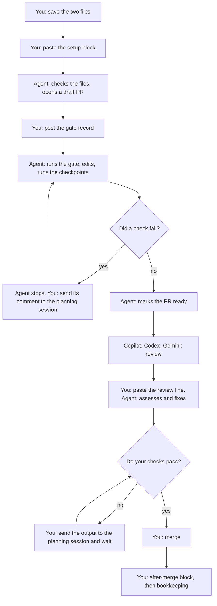

# R3b: restart housekeeping PR

_Operator guide: one page for one step. Written 2026-11-14 for the dispatch of that day._

## What this step does

The agent corrects the documents so that they match the code and the boards.
The agent changes documents only. It changes no firmware and no script.
`VERSION` stays 7.7.1.1.

## Words on this page

| Word | Meaning |
|---|---|
| You | The operator |
| The agent | Codex in VS Code on the LXC |
| The planning session | The Claude session that wrote the prompt |
| The prompt | The file `housekeeping-2026-11-14-restart-agent-prompt.md` |
| The setup block | The text that you paste to the agent first |
| The gate record | The record of the checks that the planning session ran on the prompt |

## Before you start

- [ ] PR #234 is merged.
- [ ] The checkout is on `main` and is clean: `git status --short` prints nothing.
- [ ] No other agent session works in the checkout.
- [ ] You have the setup block, the prompt, this page as a file, and the gate record.

## Steps

1. Save the prompt and this page in `/root/r3b/` on the LXC.
2. Open a new session of the agent.
3. Paste the setup block.
4. Wait for the address of the draft PR.
5. Post the gate record as the first comment of the PR.
6. Wait for the agent. It stops only when a check fails or when the work is done.
7. If the agent posts `⛔ CHECKPOINT FAILED`, paste its comment into the planning session. Do not tell the agent to make the check pass.
8. When the agent marks the PR ready, wait for the reviews of Copilot, Codex and Gemini.
9. Paste the review line to the agent (see "The review line").
10. Do the checks of "Before you merge".
11. Merge the PR.
12. Run the block of "After the merge". Paste its output into the planning session.
13. Run the block of "Bookkeeping".



## The review line

```text
Please analyze the code reviews and comments for the PR. Assess if they are warranted, if yes, implement necessary fixes. Post a comment summarizing your assessment.
```

## Before you merge

- [ ] The PR body shows PASS for §2, for CHECKPOINT A to F and for PRE-PR.
- [ ] The PR changes exactly 16 files: 13 changed and 3 new.
- [ ] The checks `preflight-and-compile` and `prompt-lint` are green.
- [ ] The record file `prompts/handoff/phase7/housekeeping-2026-11-14-restart.md` names every review and what the agent did with it.
- [ ] The hash block of the gate record prints the branch name and 15 lines that end in `OK`.

A line that ends in `FAILED` is not an error by itself. It means that a file differs from the rehearsal. Paste the output into the planning session before you merge.

## After the merge

```bash
cd /root/config/ESP32-GW-multi-sensor && git checkout main && git pull
grep -c '| HEAP-002a |' Docs/decisions/decision-log.md
grep -c '^## Amendment 2026-11 (restart)$' Docs/decisions/SEC-ADR-001-residual-vulnerabilities.md
grep -c 'sat-c5-8m-181' CURRENT-STATE.md
[ -n "$ESP_PASS" ] || echo "load the helpers first: source /root/esp-helpers.sh"
git grep -l -F -e "$ESP_PASS" -- AGENTS.md CLAUDE.md CURRENT-STATE.md Docs/development-process-guide.md prompts/phase7 prompts/handoff/phase7 || echo "none in the files agents read"
git log -1 --format='%h %s'
```

Each `grep -c` prints 1. The `git grep` line prints `none in the files agents read`. It prints file names only, never the password.

## Bookkeeping

```bash
REPO=GCV-Sleeper-Service/ESP32-GW-multi-sensor
gh issue close 213 --repo $REPO -c "Shipped in PR #226 (v7.7.1.1, chunked history streaming). Closed after the fact: the PR body had no closing keyword."
gh issue close 203 --repo $REPO -c "Shipped in PR #225 (v7.7.1.0, health-check task). Socket counters stay tracked in #205."
gh issue close 196 --repo $REPO -c "Shipped in PR #202 (v7.6.10.4, authFetch refactor)."
gh issue close 209 --repo $REPO -c "Delivered by Docs/phase-7-review-and-rewrite.md (fd863eb, 2026-05-07)."
gh api -X PATCH repos/$REPO/issues/190 -F milestone=null --jq '"issue 190 milestone: \(.milestone)"'
gh issue edit 137 166 171 --repo $REPO --milestone "Phase 7 — Per-Device Persistence"
for m in 1 2 3 4; do
  n=$(gh api repos/$REPO/milestones/$m --jq .open_issues)
  if [ "$n" = "0" ]; then gh api -X PATCH repos/$REPO/milestones/$m -f state=closed --jq '"milestone \(.number) \(.state)"'
  else echo "milestone $m has $n open issues: not closed"; fi
done
```

Expected: four issues close. The line for issue 190 ends in `null`. Four lines say `closed`. Issue 190 stays open.

Then replace the status table at the top of issue #228 with the table in section 7 of the record file.

## If something goes wrong

| What you see | What you do |
|---|---|
| A line of the setup block's file check ends in `FAILED` | Save the file again. Do not start the agent. |
| `⛔ CHECKPOINT FAILED` | Paste the agent's comment into the planning session. |
| `preflight-and-compile` is red on GitHub | Open the run, copy the failed step's last lines, and paste them into the planning session. |
| The agent asks for a login | Do not type it into the agent. This step needs no login. |
