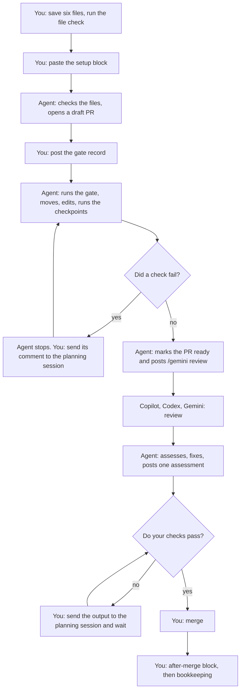

# R3c: plan into the repository

_Operator guide: one page for one step. Written 2026-11-16 for the dispatch of that day._

## What this step does

The agent brings the plan into the repository.
It adds the plan of record, the planner page, the index of the archive and two operator pages.
It moves 43 old documents into `Docs/archive/`. It changes no line in them.
It changes the instruction files, the process guide and the state file, and it adds nine decision rows.
The agent changes documents only. It changes no firmware, no script and no workflow.
`VERSION` stays 7.7.1.1.

## Words on this page

| Word | Meaning |
|---|---|
| You | The operator |
| The agent | Codex in VS Code on the LXC |
| The planning session | The session that wrote the prompt |
| The prompt | The file `plan-of-record-2026-11-16-restart-agent-prompt.md` |
| The setup block | The text that you paste to the agent first |
| The gate record | The record of the checks that the planning session ran on the prompt |
| The record file | The file that the agent writes about its own work, in `prompts/handoff/phase7/` |

## Before you start

- [ ] PR #235 is merged.
- [ ] No other agent session works in the checkout.
- [ ] You have the setup block, the gate record and six files: the prompt, `plan-of-record.md`, `planner-start-here.md`, `archive-README.md`, `R3c-plan-into-repository.md` and `R5-tooling.md`.
- [ ] The check below prints what is expected.

```bash
cd /root/config/ESP32-GW-multi-sensor && git status --short && git fetch origin && git rev-parse --short HEAD && git rev-parse --short origin/main
(exec 3<>/dev/tcp/127.0.0.1/3737) 2>/dev/null && echo "port 3737 is IN USE" || echo "port 3737 is free"
pgrep -af 'playwright|mock-server' || echo "no test process is running"
```

Expected: no file is listed. The same commit is printed twice; the gate record names it. Then `port 3737 is free` and `no test process is running`.
If the output differs, do not start the agent. Paste the output into the planning session.

## Steps

1. Save the six files in `/root/r3c/` on the LXC.
2. Run the file check of the gate record. Six lines must end in `OK`.
3. Open a new session of the agent.
4. Paste the setup block.
5. Wait for the address of the draft PR.
6. Post the gate record as the first comment of the PR.
7. Wait for the agent. It stops only when a check fails or when the work is done.
8. If the agent posts `⛔ CHECKPOINT FAILED`, paste its comment into the planning session. Do not tell the agent to make the check pass.
9. The agent marks the PR ready. From this step on it starts the review round itself: it posts `/gemini review`, waits up to 30 minutes for Copilot, Codex and Gemini, assesses the findings, fixes what is warranted, and posts one assessment. You do not paste the review line.
10. Read the assessment. It names a reviewer that did not post. Then you decide: wait for that reviewer, or go on without it.
11. Do the checks of "Before you merge".
12. Merge the PR.
13. Run the block of "After the merge". Paste its output into the planning session.
14. Do "Bookkeeping".



## Before you merge

- [ ] The PR body shows PASS for §2, for CHECKPOINT A to G and for PRE-PR.
- [ ] GitHub shows 66 changed files: 43 renamed, 16 changed and 7 new.
- [ ] Each renamed file shows no changed line. GitHub marks such a file as renamed without changes.
- [ ] In the PR, open the menu of the file `Docs/plan-of-record.md` and choose "View file". The diagram in section 7 shows four columns and 14 numbered arrows. If you see an error box in its place, do not merge. Paste the error into the planning session.
- [ ] The checks `preflight-and-compile` and `prompt-lint` are green.
- [ ] The record file names every review and what the agent did with it.
- [ ] The hash check of the gate record prints the branch name and no changed file. Compare its `OK` lines with the gate record.

A line that ends in `FAILED` is not an error by itself. It means that a file differs from the rehearsal, for example after a review fix. Paste the output into the planning session before you merge.

## After the merge

```bash
cd /root/config/ESP32-GW-multi-sensor && git checkout main && git pull
grep -c '^| 2026-11-16 | PLAN-0[23][0-9] |' Docs/decisions/decision-log.md
test -f Docs/plan-of-record.md && echo "plan of record: present"
git ls-files 'Docs/*.md' | grep -vc '^Docs/.*/'
git ls-files Docs/archive | wc -l
sed -n '3p' CLAUDE.md
git log -1 --format='%h %s'
```

Expected, line by line: `9`; `plan of record: present`; `24`; `105`; `@AGENTS.md`; the commit of the merge.
This step needs no login. If the agent asks for one, do not type it.

## Bookkeeping

Replace the status table at the top of issue #228 with the table in section 7 of the record file.
No issue closes in this step, and no milestone changes.

The next step is R5. Its page is `Docs/operator/R5-tooling.md`. Ask the planning session for the R5 prompt and its gate.

## If something goes wrong

| What you see | What you do |
|---|---|
| A line of the file check ends in `FAILED` | Save that file again. Do not start the agent. |
| `⛔ CHECKPOINT FAILED` | Paste the agent's comment into the planning session. |
| A renamed file shows changed lines | Do not merge. Paste the file name into the planning session. |
| `preflight-and-compile` is red on GitHub | Open the run, copy the last lines of the failed step, and paste them into the planning session. |
| No assessment from the agent 45 minutes after the PR is ready | Ask the agent for its status. If it waits for a reviewer, post the comment `/gemini review` on the PR yourself. |
| The agent asks for a login | Do not type it into the agent. This step needs no login. |
