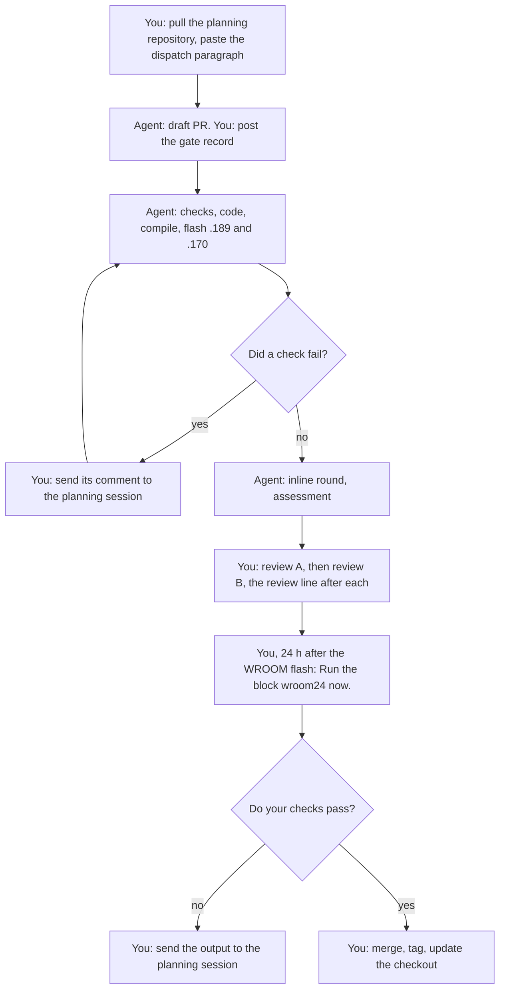

# R4: v7.7.1.2, per-device structs and keys

_Operator guide: one page for one step. Written 2026-11-22 by the planning session for R5b (PLAN-044), for the dispatch of R4 after R5b is merged._

## What this step does

The agent adds the data model of Phase 7 to the firmware: the structs that later steps will store in flash, the names of their flash keys, and a list of which devices keep history in flash. Nothing uses them yet. The agent then flashes the C3 (.189) and the WROOM (.170) with v7.7.1.2.

| Change | What it gives you |
|---|---|
| `firmware/core/data-model.h` | The structs of the per-device history and the event log for on/off sensors |
| `firmware/core/nvs-persistence.h` | Flash keys `dm_<8 hex>` and `ds_<8 hex>_<3 hex>`: up to 4,096 hours of history per device |
| `scripts/render_sensor_config.py` | The list of devices that keep history in flash, from their category |
| Version files and generated files | v7.7.1.2 everywhere |
| `CURRENT-STATE.md`, plan of record, changelog, session log, record | The documents of the step |

The step is LOW (PLAN-017). The PR gets the inline round, review A and review B. Review C does not run (PLAN-044). It closes issue #214.

## Words on this page

| Word | Meaning |
|---|---|
| You | The operator |
| The agent | The coding agent in VS Code on the LXC, as the gate record names it |
| The planning session | The session that wrote and checks the prompt |
| The setup file | The file in `steps/R4/` of your clone of the planning repository that starts the agent |
| The dispatch paragraph | The text that the planning session gives you in chat: the path of the setup file and its SHA-256 |
| The gate record | The record of the checks that the planning session ran on the prompt; your first comment on the PR |
| The review line | The one line that you paste to the agent after each external review |

## Before you start

- [ ] R5b is merged, and the planning session has run the pre-dispatch gate of R4 today and given you the dispatch paragraph.
- [ ] You ran `fleet` today, and .189 and .170 report v7.7.1.1. You pasted the output into the planning session.
- [ ] No other agent session works in the checkout.
- [ ] The check below prints what is expected. It needs the build host (the planning session cannot run it).

```bash
cd /root/config/ESP32-GW-multi-sensor && git status --short && git fetch origin && git rev-parse --short HEAD && git rev-parse --short origin/main
gh auth status >/dev/null 2>&1 && echo "gh is logged in" || echo "gh is NOT logged in"
[ -n "$ESP_USER" ] && [ -n "$ESP_PASS" ] && echo "login variables are set" || echo "login variables are NOT set"
esphome version
```

Expected: no file is listed; the same commit twice, the one the gate record names; `gh is logged in`; `login variables are set`; `Version: 2026.4.1`.
If the output differs, do not start the agent. Paste the output into the planning session.

## Steps

1. Pull your clone of the planning repository: `git -C /root/Planning-Workflow pull`.
2. Open a new session of the agent in VS Code. Paste the dispatch paragraph.
3. Wait for the address of the draft PR. Post the gate record as your first comment. A bot may post before you; that is fine.
4. Wait for the agent. It works through the checks, compiles, and flashes .189 and .170 by itself. If it posts `⛔ CHECKPOINT FAILED`, paste its comment into the planning session. Do not tell the agent to make the check pass.
5. The agent marks the PR ready and runs the inline round. It waits with the check `inline`, up to 30 minutes, then posts its assessment.
6. Start review A: Claude, in a new session. Paste the common part and part A of `prompts/phase7/v7.7.1.2-review.md`. Put the PR number in place of `<NN>` and `review A` in place of `<A | B>`. It posts one comment. Paste the review line to the agent and wait for its assessment.
7. Start review B from the Actions tab, as `Docs/operator/R5r-review-runner.md` says under "From the next code step on": the PR number, `prompts/phase7/v7.7.1.2-agent-prompt-gpt-codex.md` and `prompts/phase7/v7.7.1.2-review.md`; clear `dry_run`. Compare the two SHA-256 values in its header with the gate record. Paste the review line to the agent and wait for its assessment.
8. At least 24 hours after the agent flashed .170 (the session log has the time), paste this line to the agent: `Run the block wroom24 now.` It reads .170 and ends the round.
9. Do the checks of "Before you merge". Merge the PR.
10. Run the block of "After the merge". Tell the planning session that R4 is merged.



## The review line

```text
Please analyze the code reviews and comments for the PR. Assess if they are warranted, if yes, implement necessary fixes. Post a comment summarizing your assessment.
```

## Before you merge

- [ ] The check below prints `body final PASS` as its last line. Put the PR number in place of `<PR#>`. It needs the build host.

```bash
bash /root/v7712/v7.7.1.2-checks.sh body <PR#> final
```

- [ ] It also checks that every GitHub check on the last commit passed: `preflight-and-compile` with the C3 compile, `prompt-lint`, `pr-body-check` and the seven `browser-tests` jobs.
- [ ] The PR body shows `dev 192.168.120.189: version v7.7.1.2`, `dev 192.168.120.170: version v7.7.1.2` and the `wroom24` line.
- [ ] Review A names its model in its first line; review B's header shows the SHA-256 values of the gate record.
- [ ] No review and no comment holds a login.

If `body final` fails, paste its output to the agent with this line: `Please fix the PR body as the check says, then run the block body again and post its last line.` Then run the check again.

## After the merge

```bash
cd /root/config/ESP32-GW-multi-sensor && git checkout main && git pull
git tag -a v7.7.1.2 -m "v7.7.1.2: per-device structs, NVS key scheme, FNV-1a hash and persist defaults" && git push origin v7.7.1.2
```

The block needs the build host and your GitHub login; the planning session cannot run it and checked it against the git manual. Then check on GitHub that issue #214 is closed. The planning session checks `main` at its next restart check and produces the bundle of v7.7.1.3.

## Bookkeeping

The tag `v7.7.1.2` and the closing of #214 (by the line `Fixes #214`) are the only bookkeeping. The milestone "Phase 7 — Per-Device Persistence" moves by itself.

## If something goes wrong

| What you see | What you do |
|---|---|
| `⛔ CHECKPOINT FAILED` | Paste the agent's comment into the planning session. |
| `c3heap` fails: `free_heap ... is not within 2,048 B` | The agent stops. Paste its comment into the planning session; do not merge. |
| The WROOM compile fails on a size assertion | The agent stops. Paste its comment into the planning session. |
| `wroom24` says the uptime is below 86,400 s | Wait, if 24 hours have not passed. If they have, .170 rebooted: paste the line into the planning session. |
| An upload ends with a timeout | Paste the agent's comment into the planning session. Do not flash by hand. |
| A check on GitHub is red | Open the run, copy the last lines of the failed step, and paste them into the planning session. |
| The agent asks for a login | Do not type it into the agent. The login stays in `$ESP_USER` and `$ESP_PASS` in your shell. |
