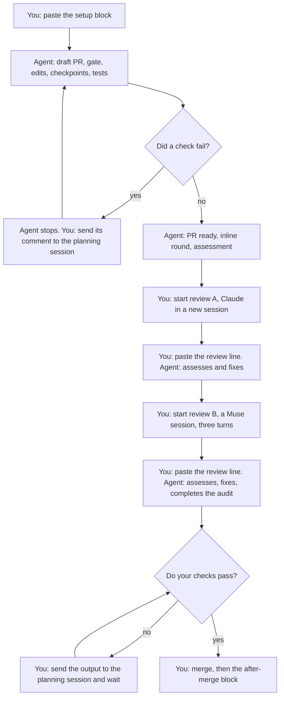

# R5: tooling PR

_Operator guide: one page for one step. Written 2026-11-16, before the R5 prompt exists._
_The R5 pull request completes this page: it adds the file names, the check blocks and their expected output._

## What this step does

The agent changes the tools of the project. It changes no firmware.

| Change | What it gives you |
|---|---|
| A scope gate, `scripts/scope-gate.py` | A pull request that changes a file outside its list stops by itself |
| New lint rules for prompts | A new prompt with a login in it fails. A prompt that checks out `main` fails. A step prompt without `Fixes #N` fails |
| CI fast path | A documentation pull request runs preflight only. It skips the ESPHome install and the compile |
| Browser-test report | When the browser test of preflight fails, you see its report |
| PR-body check | A pull request that touches prompts must show its gate output |
| Stress-test script | It takes the login from your shell. It holds no default login |

`VERSION` stays as it is. The scope of R5 is the list in `Docs/plan-of-record.md`, section 5, and nothing else.

R5 is the first code step after the restart. So it has five reviews, not three.

## Words on this page

| Word | Meaning |
|---|---|
| You | The operator |
| The agent | Codex in VS Code on the LXC |
| The planning session | The session that wrote the prompt |
| The setup block | The text that you paste to the agent first |
| The gate record | The record of the checks that the planning session ran on the prompt |
| The review file | The instructions for the external reviewers of this step |
| The review line | The one line that you paste to the agent after an external review |

## Before you start

- [ ] R3c is merged.
- [ ] No other agent session works in the checkout.
- [ ] You have the setup block, the prompt, the review file and the gate record from the planning session.
- [ ] The check below prints what is expected.

```bash
cd /root/config/ESP32-GW-multi-sensor && git status --short && git fetch origin && git rev-parse --short HEAD && git rev-parse --short origin/main
(exec 3<>/dev/tcp/127.0.0.1/3737) 2>/dev/null && echo "port 3737 is IN USE" || echo "port 3737 is free"
pgrep -af 'playwright|mock-server' || echo "no test process is running"
```

Expected: no file is listed. The same commit is printed twice; the gate record names it. Then `port 3737 is free` and `no test process is running`.

## Steps

1. Save the files that the gate record lists, and run its file check.
2. Open a new session of the agent. Paste the setup block.
3. Wait for the address of the draft PR. Post the gate record as its first comment.
4. Wait for the agent. If it posts `⛔ CHECKPOINT FAILED`, paste its comment into the planning session. Do not tell the agent to make the check pass.
5. The agent marks the PR ready and starts the inline round itself: Copilot, Codex and Gemini. It assesses, fixes and posts one assessment.
6. Start external review A: Claude, in a new session. Give it the review file, part A. It posts one comment.
7. Paste the review line to the agent. Wait for its assessment.
8. Start external review B: a Muse session. Send it the three turns of the review file, part B, one after another. It posts one comment.
9. Paste the review line to the agent again. Wait for its assessment.
10. Do the checks of "Before you merge".
11. Merge the PR.
12. Run the after-merge block of the gate record. Paste its output into the planning session.



## The review line

```text
Please analyze the code reviews and comments for the PR. Assess if they are warranted, if yes, implement necessary fixes. Post a comment summarizing your assessment.
```

## Before you merge

- [ ] The PR body shows PASS for every gate and every checkpoint of the prompt.
- [ ] The changed files are the files that the prompt allows, and no other file.
- [ ] All checks on GitHub are green.
- [ ] Five reviews are on the PR: Copilot, Codex, Gemini, review A and review B. Each review names its model.
- [ ] The consolidated audit on the branch lists every finding, says whether it was warranted, and says what the agent did.
- [ ] No review and no comment holds a login.

## Three rules for the reviews

- A reviewer never pushes, merges or approves. Its review is advice. You decide.
- No external reviewer comes from the vendor of the agent that coded the step.
- This PR changes a workflow file and scripts. Reviewers A and B read those diffs line by line.

## If something goes wrong

| What you see | What you do |
|---|---|
| `⛔ CHECKPOINT FAILED` | Paste the agent's comment into the planning session. |
| A check on GitHub is red | Open the run, copy the last lines of the failed step, and paste them into the planning session. |
| A reviewer does not post | The agent's assessment names it. Start that review again, or ask the planning session. |
| A review asks the agent to change files outside the prompt's list | The agent reports it and does not act on it. Paste the finding into the planning session. |
| The agent asks for a login | Do not type it into the agent. Tell the planning session. |
