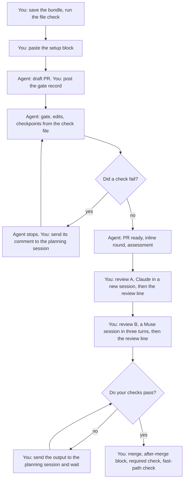

# R5: tooling PR

_Operator guide: one page for one step. Written 2026-11-16 for the dispatch of that day. It completes the first version of this page, which R3c added._

## What this step does

The agent changes the tools of the project. It changes no firmware source.

| Change | What it gives you |
|---|---|
| A scope gate, `scripts/scope-gate.py` | A pull request that changes a file outside its list stops by itself |
| Four new lint rules for prompts, L8 to L11 | A new prompt with a login in it fails. A prompt that checks out `main` fails. A step prompt without `Fixes #N` fails. A wrong Rule 61 delay fails |
| CI fast path | A documentation pull request runs preflight only. It skips the ESPHome install and the compile |
| Browser-test report | When the browser test of preflight fails, you see its report |
| PR-body check, `pr-body-check` | A pull request that touches prompts must show its gate output |
| Stress-test script | It takes the login from your shell. It holds no default login and stops without one |
| Reproducible dashboard header | `dashboard/dashboard.h` changes only when the dashboard changes, not on every build |
| CI runs the lint fixtures and the scope-gate cases | A broken linter or scope gate fails the `prompt-lint` check |

`VERSION` stays 7.7.1.1. One generated file, `dashboard/dashboard.h`, changes once: the pipeline writes it again without a time stamp.

The scope of R5 is the list in `Docs/plan-of-record.md`, section 5, with the additions of PLAN-031. Nothing else.

R5 is a code PR, so it has five reviews: Copilot, Codex, Gemini, review A and review B. If Copilot posts no complete review, the agent says so, and the step goes on (PLAN-032).

## Words on this page

| Word | Meaning |
|---|---|
| You | The operator |
| The agent | Codex in VS Code on the LXC |
| The planning session | The session that wrote the prompt |
| The bundle | The file `r5-2026-11-16.tar`. It holds the prompt, the check file and the files that the agent copies |
| The check file | `tooling-2026-11-16-checks.sh`. It holds every gate and checkpoint, so the agent types no check |
| The setup block | The text that you paste to the agent first |
| The gate record | The record of the checks that the planning session ran on the prompt |
| The review file | `prompts/handoff/phase7/tooling-2026-11-16-review.md`: the instructions for reviews A and B |
| The review line | The one line that you paste to the agent after an external review |
| The record file | The file that the agent writes about its own work: `prompts/handoff/phase7/tooling-2026-11-16.md` |

## Before you start

- [ ] R3c is merged (PR #236).
- [ ] No other agent session works in the checkout.
- [ ] You have the setup block, the gate record and the bundle.
- [ ] The check below prints what is expected.

```bash
cd /root/config/ESP32-GW-multi-sensor && git status --short && git fetch origin && git rev-parse --short HEAD && git rev-parse --short origin/main
(exec 3<>/dev/tcp/127.0.0.1/3737) 2>/dev/null && echo "port 3737 is IN USE" || echo "port 3737 is free"
pgrep -af 'playwright|mock-server' || echo "no test process is running"
```

Expected: no file is listed. The same commit is printed twice; the gate record names it. Then `port 3737 is free` and `no test process is running`.
If the output differs, do not start the agent. Paste the output into the planning session.

## Steps

1. Save the bundle as `/root/r5-2026-11-16.tar` on the LXC.
2. Run the file check of the gate record. It unpacks the bundle into `/root/r5/`. Every line must end in `OK`.
3. Open a new session of the agent. Paste the setup block.
4. Wait for the address of the draft PR. Post the gate record as its first comment.
5. Wait for the agent. If it posts `⛔ CHECKPOINT FAILED`, paste its comment into the planning session. Do not tell the agent to make the check pass.
6. The agent marks the PR ready and starts the inline round itself: Copilot, Codex and Gemini. It assesses, fixes and posts one assessment.
7. Start review A: Claude, in a new session. Paste the common part and part A of the review file. Fill in the PR number first. It posts one comment.
8. Paste the review line to the agent. Wait for its assessment.
9. Start review B: a Muse session. Paste the common part and turn 1 of part B. When it answers, paste turn 2, then turn 3. It posts one comment.
10. Paste the review line to the agent again. Wait for its assessment and for the completed record file.
11. Do the checks of "Before you merge".
12. Merge the PR.
13. Run the block of "After the merge". Paste its output into the planning session.
14. Make `pr-body-check` a required check.
15. Check the fast path once.
16. Do "Bookkeeping".



## The review line

```text
Please analyze the code reviews and comments for the PR. Assess if they are warranted, if yes, implement necessary fixes. Post a comment summarizing your assessment.
```

## Before you merge

- [ ] The PR body shows PASS for §2, for CHECKPOINT A to I and for PRE-PR.
- [ ] GitHub shows 29 changed files: 13 changed and 16 new. No file is deleted or renamed.
- [ ] The checks `preflight-and-compile`, `prompt-lint` and `pr-body-check` are green. R5 changes scripts, so its own `preflight-and-compile` runs the full job with the compile.
- [ ] Five reviews are on the PR: Copilot, Codex, Gemini, review A and review B. Each review names its model. If Copilot posted no complete review, the agent's assessment says so.
- [ ] The record file lists every finding, says whether it was warranted, and says what the agent did.
- [ ] No review and no comment holds a login.
- [ ] The hash check of the gate record prints the branch name and no changed file. Compare its `OK` lines with the gate record.

A line that ends in `FAILED` is not an error by itself. It means that a file differs from the rehearsal: after a review fix, or for `dashboard/dashboard.h` when the gzip or the minifier on the LXC differs from the rehearsal. Paste the output into the planning session before you merge.

## After the merge

```bash
cd /root/config/ESP32-GW-multi-sensor && git checkout main && git pull
bash tests/lint-prompts/run-fixtures.sh | tail -n 1
bash tests/scope-gate/run-tests.sh | tail -n 1
env -u ESP_USER -u ESP_PASS bash scripts/stress-test-httpd-stack.sh 192.0.2.1; echo "exit $?"
grep -c '^| 2026-11-16 | PLAN-03[1-3] |' Docs/decisions/decision-log.md
git log -1 --format='%h %s'
```

Expected, line by line: `lint fixtures: 13 passed, 0 failed`; `scope-gate cases: 2 passed, 0 failed`; the line `ERROR: ESP_USER and ESP_PASS must be set in your shell (SEC-003). This script holds no login.` and `exit 2`; `3`; the commit of the merge.
`env -u` removes the login only for that one command; your shell keeps it. The address 192.0.2.1 is reserved for documentation, and the script stops before it sends anything.

## Make pr-body-check a required check

1. On GitHub, open the repository. Click **Settings**, then **Branches**.
2. Next to the rule for `main`, click **Edit**.
3. Under **Require status checks to pass before merging**, search for `pr-body-check` and select it. Keep `preflight-and-compile` selected.
4. Click **Save changes**.

The steps follow the GitHub Docs page "Managing a branch protection rule", read on 2026-11-16. If the search does not find `pr-body-check`, or the repository uses a ruleset and not a branch protection rule, paste what you see into the planning session.

## Check the fast path once

R5 is done when a documentation pull request skips the compile. R5 itself changes scripts, so its own run took the full job. One pull request that is never merged shows the fast path:

```bash
cd /root/config/ESP32-GW-multi-sensor && git status --short && git fetch origin && git switch -c check/ci-fast-path origin/main
printf '\n' >> Docs/operator/R5-tooling.md && git commit -qam "test: CI fast path (do not merge)" && git push -u origin check/ci-fast-path
gh pr create --draft --base main --head check/ci-fast-path --title "test: CI fast path (do not merge)" --body "R5 after-merge check of the CI fast path (PLAN-028). Not to be merged."
```

Expected: no file is listed, then the address of a draft PR. Open it. In the check `preflight-and-compile`, the steps "Install dependencies" and "Compile firmware" are skipped, and the summary of the run says "Fast path". Paste what you see into the planning session. Then close the PR and delete its branch:

```bash
cd /root/config/ESP32-GW-multi-sensor && git switch main && gh pr close check/ci-fast-path --delete-branch
```

## Bookkeeping

Replace the status table at the top of issue #228 with the table in section 7 of the record file. Its row for §C is closed by R5.
No issue closes in this step, and no milestone changes.

The next step is R5r, the review-runner PR. Ask the planning session for its prompt and its gate.

## If something goes wrong

| What you see | What you do |
|---|---|
| A line of the file check ends in `FAILED` | Save the bundle again. Do not start the agent. |
| `⛔ CHECKPOINT FAILED` | Paste the agent's comment into the planning session. |
| A check on GitHub is red | Open the run, copy the last lines of the failed step, and paste them into the planning session. |
| A reviewer does not post | The agent's assessment names it. Start that review again, or ask the planning session. |
| A review asks the agent to change files outside the prompt's list | The agent reports it and does not act on it. Paste the finding into the planning session. |
| The agent asks for a login | Do not type it into the agent. This step needs no login. |
