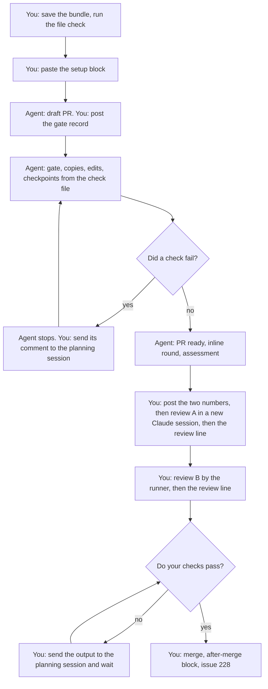

# R5a: producer contract

_Operator guide: one page for one step. Written 2026-11-21 by the planning session, for the dispatch of that day or later._

## What this step does

The agent adds three texts and changes seven documents. It changes no firmware, no script and no workflow.

| Change | What it gives you |
|---|---|
| `prompts/producer-contract.md` | One short file with every binding rule for producing a prompt bundle. Each rule names the lint rule, the gate or the judgment that enforces it |
| `prompts/handoff/phase7-batch-production-prompt-v3.md` | The batch-production prompt, version 3.0. It is much shorter than version 2.0, because the rules moved into the contract |
| `.gemini/styleguide.md` | The Gemini reviewer gets the review rules of `AGENTS.md`, copied word for word |
| `Docs/planner-start-here.md` | The planner reads the contract; checks the runner's models at each restart; runs an internal audit before an external one; and leaves the bundle in the planning repository. Its rule lists moved into the contract |
| `Docs/development-process-guide.md` | The bundle is defined by the contract; `.gemini/styleguide.md` is listed with the other instruction files |
| `CURRENT-STATE.md`, `Docs/plan-of-record.md` | The runner's two runs are done; R5a is done; the next step is R5b; the open items of PR #240 are routed |
| `Docs/decisions/decision-log.md` | Four rows, PLAN-038 to PLAN-041: the choices of R5a and your decisions of 2026-11-19 and 2026-11-21 |
| `Docs/templates/prompt-audit-template.md`, `Docs/archive/README.md` | The audit template names the contract; the tracking supplement moves to `Docs/archive/planning-2026-05/` |

`VERSION` stays 7.7.1.1. No generated file changes. The scope is the block of R5a in `Docs/plan-of-record.md` and the decisions PLAN-038 to PLAN-041.

R5a is LOW, by your decision of 2026-11-21. Its producer audit is an internal sub-agent audit, with no external auditor. The PR gets the inline round (Copilot, Codex and Gemini), then review A and review B by the runner. Review C does not run.

## Words on this page

| Word | Meaning |
|---|---|
| You | The operator |
| The agent | Codex in VS Code on the LXC |
| The planning session | The session that wrote the prompt |
| The bundle | The file `r5a-2026-11-21.tar`. It holds the prompt, the check file and the seven files that the agent copies |
| The check file | `producer-contract-2026-11-21-checks.sh`. It holds every gate and checkpoint, so the agent types no check |
| The setup block | The text that you paste to the agent first |
| The gate record | The record of the checks that the planning session ran on the prompt |
| The review file | `prompts/handoff/phase7/producer-contract-2026-11-21-review.md`: the instructions for reviews A and B |
| The runner | The workflow "External Review" on GitHub. It runs review B |
| The review line | The one line that you paste to the agent after an external review |
| The record file | The file that the agent writes about its own work: `prompts/handoff/phase7/producer-contract-2026-11-21.md` |

## Before you start

- [ ] R5r is merged (PR #240).
- [ ] No other agent session works in the checkout.
- [ ] You have the setup block, the gate record and the bundle.
- [ ] The check below prints what is expected.

```bash
cd /root/config/ESP32-GW-multi-sensor && git status --short && git fetch origin && git rev-parse --short HEAD && git rev-parse --short origin/main
(exec 3<>/dev/tcp/127.0.0.1/3737) 2>/dev/null && echo "port 3737 is IN USE" || echo "port 3737 is free"
pgrep -af 'playwright|mock-server' || echo "no test process is running"
locale -a | grep -ixE 'en_US\.utf-?8' || echo "no en_US.UTF-8 locale"
```

Expected: no file is listed. The same commit is printed twice; the gate record names it. Then `port 3737 is free`, `no test process is running`, and `en_US.utf8`.
If the output differs, do not start the agent. Paste the output into the planning session.

## Steps

1. Save the bundle as `/root/r5a-2026-11-21.tar` on the LXC.
2. Run the file check of the gate record. It unpacks the bundle into `/root/r5a/`. Every line must end in `OK`.
3. Open a new session of the agent. Paste the setup block.
4. Wait for the address of the draft PR. Post the gate record as its first comment.
5. Wait for the agent. If it posts `⛔ CHECKPOINT FAILED`, paste its comment into the planning session. Do not tell the agent to make the check pass.
6. The agent marks the PR ready and starts the inline round itself: Copilot, Codex and Gemini. It assesses, fixes and posts one assessment.
7. Post one comment on the PR with these two lines:
   `Producer sessions for this step's prompt: 1.`
   `Audit sessions for this step's prompt: 0. R5a is LOW: no external auditor; internal audit rounds are not official rounds (PLAN-037, PLAN-040).`
8. Start review A: Claude, in a new session. Paste the common part and part A of the review file. Fill in the PR number first. It posts one comment.
9. Paste the review line to the agent. Wait for its assessment.
10. Start review B with the runner, as the next section says. When the comment is on the PR, paste the review line to the agent. Wait for its assessment and for the completed record file.
11. Do the checks of "Before you merge".
12. Merge the PR.
13. Run the block of "After the merge". Paste the output into the planning session.
14. Do the bookkeeping.



## Review B by the runner

1. If the PR has an earlier comment of the runner, delete it first, so that the model does not review its own earlier output.
2. On GitHub, click **Actions**, then **External Review**, then **Run workflow**.
3. "Use workflow from": Branch `main`. Fill in:
   - `pr`: the number of the R5a pull request
   - `prompt_path`: `prompts/handoff/phase7/producer-contract-2026-11-21-agent-prompt.md`
   - `review_path`: `prompts/handoff/phase7/producer-contract-2026-11-21-review.md`
   - `model` `gemini-4-hydrogen`, `thinking_level` `HIGH`, `profile` `default`, and clear `dry_run`.
4. Click **Run workflow**. When the run is green, the PR has one comment by `github-actions[bot]` whose first line is `## Review B - runner: gemini-4-hydrogen, thinking HIGH`.
5. Compare the SHA-256 of the agent prompt and of the review file in the comment's header with the gate record. If one differs, do not use the review: paste the header into the planning session.

The runner gets no check-run data yet. So review B marks the CI gates UNCLEAR and may advise FIX FIRST for that reason alone (`CURRENT-STATE.md`, routed to the runner-hardening step). Check the CI gates yourself in "Before you merge". If the run fails, see the table "If a run fails" in `Docs/operator/R5r-review-runner.md`.

## The review line

```text
Please analyze the code reviews and comments for the PR. Assess if they are warranted, if yes, implement necessary fixes. Post a comment summarizing your assessment.
```

## Before you merge

- [ ] The PR body shows PASS for §2, for CHECKPOINT A to D and for PRE-PR. The last line `PRE-PR PASS at <commit>` names the head of the PR.
- [ ] GitHub shows 16 files: 7 changed, 8 new, and one renamed to `Docs/archive/planning-2026-05/phase7-github-tracking-supplement.md` with no change inside it.
- [ ] The checks `preflight-and-compile`, `prompt-lint` and `pr-body-check` are green. `preflight-and-compile` runs the full job with the compile, because `.gemini/styleguide.md` is not a documentation path of the CI fast path. Browser Tests does not run on this PR.
- [ ] Five reviewers were asked: Copilot, Codex, Gemini, review A and review B. Each review that posted names its model. If Copilot posted no complete review, the agent's assessment says so, and the step goes on (PLAN-032).
- [ ] The record file lists every finding, says whether it was warranted, and says what the agent did. Its §8 shows your two numbers.
- [ ] No review and no comment holds a login.

## After the merge

```bash
cd /root/config/ESP32-GW-multi-sensor && git checkout main && git pull
wc -l < prompts/producer-contract.md
bash scripts/lint-prompts.sh prompts/producer-contract.md prompts/handoff/phase7-batch-production-prompt-v3.md | tail -n 1
grep -cE '^\| 2026-11-21 \| PLAN-0(38|39|40|41) \|' Docs/decisions/decision-log.md
test -f Docs/archive/planning-2026-05/phase7-github-tracking-supplement.md && echo "supplement archived"
git log -1 --format='%h %s'
```

Expected, after the lines that `git checkout` and `git pull` print, line by line: `90`; `lint-prompts: OK — 0 violations`; `4`; `supplement archived`; the commit of the merge.

The merge starts no CI run on `main`, because R5a changes no code path. The next dispatch needs a green CI run on `main` that is at most 7 days old (PLAN-034); the planning session checks it.

## Bookkeeping

No issue closes in this step, and no milestone changes. Edit the body of issue #228: in its status table, the row "§E producer-prompt evolution" becomes `CLOSED — producer contract and batch-production prompt v3.0 (R5a, PR #<number>)`.

The next step is R5b, the Batch 2 prompts. Ask the planning session for it.

## If something goes wrong

| What you see | What you do |
|---|---|
| A line of the file check ends in `FAILED` | Save the bundle again. Do not start the agent. |
| `no en_US.UTF-8 locale` in the check before the start | Do not start the agent. Paste the output into the planning session. |
| `⛔ CHECKPOINT FAILED` | Paste the agent's comment into the planning session. |
| A check on GitHub is red | Open the run, copy the last lines of the failed step, and paste them into the planning session. |
| A reviewer does not post | The agent's assessment names it. Start that review again, or ask the planning session. |
| The runner cannot run | The step waits for it, or you run review B as a Muse session in three turns with part B of the review file; the record file names the change (PLAN-023). |
| A review asks the agent to change files outside the prompt's list | The agent reports it and does not act on it. Paste the finding into the planning session. |
| The agent asks for a login | Do not type it into the agent. This step needs no login. |
