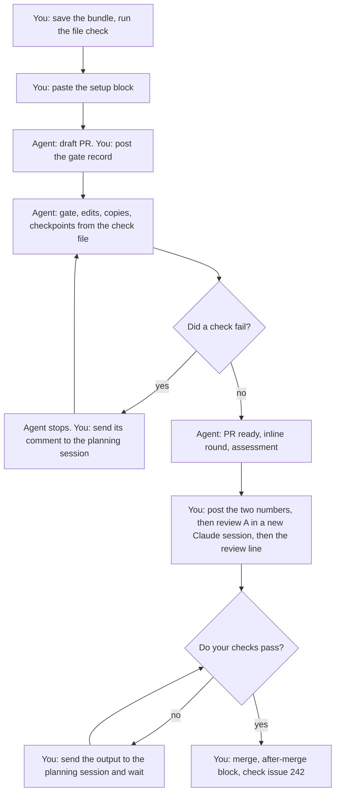

# R5a.1: producer-contract fixes

_Operator guide: one page for one step. Written 2026-11-21 by the planning session, for the dispatch of that day or later._

## What this step does

The agent fixes the findings of issue #242 in the producer contract and in the documents that state the same rules. It changes no firmware, no script and no workflow.

| Change | What it gives you |
|---|---|
| `prompts/producer-contract.md` | Eleven rules fixed: review A's M1, M2, L1, L2 and L5 of PR #241, and your answers to Q1 and Q2 |
| `prompts/handoff/phase7-batch-production-prompt-v3.md` | The three searches print every line; Batch 2 starts after R5a.1 |
| `prompts/phase7/consolidated-audit-template-phase7.md` | One line that says how to count the defects that escaped into agent execution |
| `Docs/development-process-guide.md`, `Docs/templates/prompt-audit-template.md` | Every tier compiles the code that its prompt carries, before dispatch |
| `Docs/planner-start-here.md` | The start prompt says how the planner checks a board command that it cannot run, and that `curl -u "$ESP_USER:$ESP_PASS"` stays allowed in your commands |
| `CURRENT-STATE.md` | One new row: the Gemini style-guide check goes to a later tooling step |
| `Docs/plan-of-record.md` | Row 6a and a block for R5a.1; R5b now needs R5a.1 |
| `Docs/decisions/decision-log.md` | One row, PLAN-042: your decisions of 2026-11-21 |
| `prompts/handoff/phase7/producer-contract-2026-11-21.md` | The record of R5a counts 7 escaped defects, not 1, and routes the style-guide check |

`VERSION` stays 7.7.1.1. No generated file changes. The PR closes issue #242.

R5a.1 is LOW, by your decision of 2026-11-21. Its producer audit was lint and one internal sub-agent round, with no external auditor. The PR gets the inline round (Copilot, Codex and Gemini), then review A. Reviews B and C do not run.

## Words on this page

| Word | Meaning |
|---|---|
| You | The operator |
| The agent | Codex in VS Code on the LXC |
| The planning session | The session that wrote the prompt |
| The bundle | The file `r5a1-2026-11-21.tar`. It holds the prompt, the check file and the two files that the agent copies |
| The check file | `contract-fixes-2026-11-21-checks.sh`. It holds every gate and checkpoint, so the agent types no check |
| The setup block | The text that you paste to the agent first |
| The gate record | The record of the checks that the planning session ran on the prompt |
| The review file | `prompts/handoff/phase7/contract-fixes-2026-11-21-review.md`: the instructions for review A |
| The review line | The one line that you paste to the agent after review A |
| The record file | The file that the agent writes about its own work: `prompts/handoff/phase7/contract-fixes-2026-11-21.md` |

## Before you start

- [ ] R5a is merged (PR #241).
- [ ] No other agent session works in the checkout.
- [ ] You have the setup block, the gate record and the bundle.
- [ ] The check below prints what is expected.

```bash
cd /root/config/ESP32-GW-multi-sensor && git status --short && git fetch origin && git rev-parse --short HEAD && git rev-parse --short origin/main
(exec 3<>/dev/tcp/127.0.0.1/3737) 2>/dev/null && echo "port 3737 is IN USE" || echo "port 3737 is free"
pgrep -af 'playwright|mock-server' || echo "no test process is running"
locale -a | grep -ixE 'en_US\.utf-?8' || echo "no en_US.UTF-8 locale"
```

Expected: no file is listed. The same commit is printed twice; the gate record names it. Then `port 3737 is free`, `no test process is running`, and `en_US.utf8`.
If the output differs, do not start the agent. Paste the output into the planning session.

## Steps

1. Save the bundle as `/root/r5a1-2026-11-21.tar` on the LXC.
2. Run the file check of the gate record. It unpacks the bundle into `/root/r5a1/`. Every line must end in `OK`.
3. Open a new session of the agent. Paste the setup block.
4. Wait for the address of the draft PR. Post the gate record as its first comment.
5. Wait for the agent. If it posts `⛔ CHECKPOINT FAILED`, paste its comment into the planning session. Do not tell the agent to make the check pass.
6. The agent marks the PR ready and starts the inline round itself: Copilot, Codex and Gemini. It assesses, fixes and posts one assessment.
7. Post one comment on the PR with these two lines:
   `Producer sessions for this step's prompt: 1.`
   `Audit sessions for this step's prompt: 0. R5a.1 is LOW: no external auditor; internal audit rounds are not official rounds (PLAN-037, PLAN-040).`
8. Start review A: Claude, in a new session. Paste the common part and part A of the review file. Fill in the PR number first. It posts one comment.
9. Paste the review line to the agent. Wait for its assessment and for the completed record file.
10. Do the checks of "Before you merge".
11. Merge the PR.
12. Run the block of "After the merge". Paste the output into the planning session.
13. Do the bookkeeping.



## The review line

```text
Please analyze the code reviews and comments for the PR. Assess if they are warranted, if yes, implement necessary fixes. Post a comment summarizing your assessment.
```

## Before you merge

- [ ] The PR body shows PASS for §2, for CHECKPOINT A to D and for PRE-PR. The last line `PRE-PR PASS at <commit>` names the head of the PR.
- [ ] GitHub shows 15 files: 10 changed and 5 new.
- [ ] The checks `preflight-and-compile`, `prompt-lint` and `pr-body-check` are green. `preflight-and-compile` takes the fast path for documentation: preflight only, no compile. Browser Tests does not run on this PR.
- [ ] Four reviewers were asked: Copilot, Codex, Gemini and review A. Review A names its model in its first line, and each assessment of the agent names the agent and its model. If Copilot posted no complete review, the agent's assessment says so, and the step goes on (PLAN-032).
- [ ] The record file lists every finding, says whether it was warranted, and says what the agent did. Its §8 shows your two numbers.
- [ ] The PR body ends with the line `Fixes #242`.
- [ ] No review and no comment holds a login.

## After the merge

```bash
cd /root/config/ESP32-GW-multi-sensor && git checkout main && git pull
wc -l < prompts/producer-contract.md
bash scripts/lint-prompts.sh prompts/producer-contract.md prompts/handoff/phase7-batch-production-prompt-v3.md | tail -n 1
grep -c '^| 2026-11-21 | PLAN-042 |' Docs/decisions/decision-log.md
grep -c 'head -5' prompts/handoff/phase7-batch-production-prompt-v3.md
git log -1 --format='%h %s'
```

Expected, after the lines that `git checkout` and `git pull` print, line by line: `90`; `lint-prompts: OK — 0 violations`; `1`; `0`; the commit of the merge.

The merge starts no CI run on `main`, because R5a.1 changes no code path. The next dispatch needs a green CI run on `main` that is at most 7 days old (PLAN-034); the planning session checks it.

## Bookkeeping

The merge closes issue #242 through the line `Fixes #242`. Open issue #242 on GitHub: it shows "Closed". If it is still open, close it by hand with a comment that names the PR. No milestone changes, and the step has no tag.

The next step is R5b, the Batch 2 prompts. Ask the planning session for it.

## If something goes wrong

| What you see | What you do |
|---|---|
| A line of the file check ends in `FAILED` | Save the bundle again. Do not start the agent. |
| `no en_US.UTF-8 locale` in the check before the start | Do not start the agent. Paste the output into the planning session. |
| `⛔ CHECKPOINT FAILED` | Paste the agent's comment into the planning session. |
| A check on GitHub is red | Open the run, copy the last lines of the failed step, and paste them into the planning session. |
| A reviewer does not post | The agent's assessment names it. Start that review again, or ask the planning session. |
| A review asks the agent to change files outside the prompt's list | The agent reports it and does not act on it. Paste the finding into the planning session. |
| The agent asks for a login | Do not type it into the agent. This step needs no login. |
