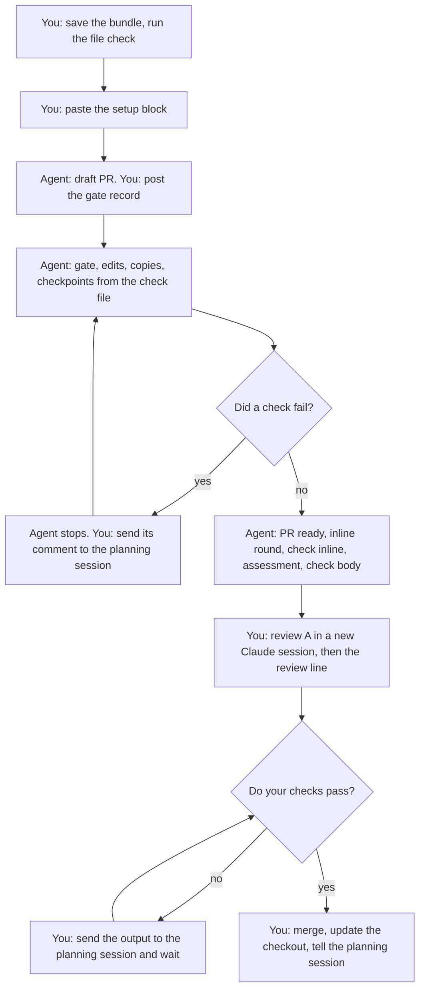

# R5a.2: method fixes

_Operator guide: one page for one step. Written 2026-11-21 by the planning session, for the dispatch of that day or later._

## What this step does

The agent writes the method changes that you decided on 2026-11-21 into the rules. It changes no firmware, no script and no workflow. Its check file has two new checks for the review round, `inline` and `body`, and this PR is their first use.

| Change | What it gives you |
|---|---|
| `prompts/producer-contract.md` | One internal audit round at every tier; dispatch by a setup file; the gate record as your first comment, with the two numbers; the Round Summary and the end of each round; review A's Q1 and Q2 of PR #243 |
| `prompts/phase7/consolidated-audit-template-phase7.md` | What counts as a fix cycle and a fix-cycle commit (Q4) |
| `prompts/handoff/phase7-batch-production-prompt-v3.md` | Batch 2 starts after R5a.2 |
| `Docs/development-process-guide.md` | The dispatch paragraph, the setup block with the checks `inline` and `body`, the coding agent, the tier table, what a fix cycle is |
| `Docs/planner-start-here.md` | The internal round at every tier, the hand-over, the check after the merge, `curl -u` in the agent's commands too (Q3), the filled start prompt at the end of "Read first" |
| `Docs/templates/prompt-audit-template.md` | The internal round at every tier; version 1.5 |
| `CURRENT-STATE.md` | Three new rows: the Gemini config test, a stronger `pr-body-check`, the old line about PRs #176-178 in `AGENTS.md` |
| `Docs/plan-of-record.md` | Row 6b and a block for R5a.2; R5b now needs R5a.2 and has an internal round at every tier; the standard procedure |
| `Docs/decisions/decision-log.md` | One row, PLAN-043: your decisions of 2026-11-21 |
| `prompts/handoff/phase7/contract-fixes-2026-11-21.md` | The record of R5a.1 counts 1 fix-cycle commit and 2 escaped defects |

`VERSION` stays 7.7.1.1. No generated file changes. The PR closes no issue.

R5a.2 is LOW, by your decision of 2026-11-21. Its producer audit was lint and one internal sub-agent round, with no external auditor. The PR gets the inline round (Copilot, Codex and Gemini), then review A. Reviews B and C do not run.

This step is still dispatched the old way: you save the bundle and paste the setup block. The dispatch by a setup file starts with R5b.

## Words on this page

| Word | Meaning |
|---|---|
| You | The operator |
| The agent | The GitHub Copilot Chat agent in VS Code on the LXC, with the model GPT-5.3-Codex, as you named it on 2026-11-21. If you run another agent or model, tell the planning session before you start |
| The planning session | The session that wrote the prompt |
| The bundle | The file `r5a2-2026-11-21.tar`. It holds the prompt, the check file and the two files that the agent copies |
| The check file | `method-fixes-2026-11-21-checks.sh`. It holds every gate and checkpoint, so the agent types no check |
| The setup block | The text that you paste to the agent first |
| The gate record | The record of the checks that the planning session ran on the prompt. It also gives the two numbers for the record file |
| The review file | `prompts/handoff/phase7/method-fixes-2026-11-21-review.md`: the instructions for review A |
| The review line | The one line that you paste to the agent after review A |
| The record file | The file that the agent writes about its own work: `prompts/handoff/phase7/method-fixes-2026-11-21.md` |

## Before you start

- [ ] R5a.1 is merged (PR #243).
- [ ] No other agent session works in the checkout.
- [ ] You have the setup block, the gate record and the bundle.
- [ ] The check below prints what is expected.

```bash
cd /root/config/ESP32-GW-multi-sensor && git status --short && git fetch origin && git rev-parse --short HEAD && git rev-parse --short origin/main
(exec 3<>/dev/tcp/127.0.0.1/3737) 2>/dev/null && echo "port 3737 is IN USE" || echo "port 3737 is free"
pgrep -af 'playwright|mock-server' || echo "no test process is running"
locale -a | grep -ixE 'en_US\.utf-?8' || echo "no en_US.UTF-8 locale"
gh auth status >/dev/null 2>&1 && echo "gh is logged in" || echo "gh is NOT logged in"
```

Expected: no file is listed. The same commit is printed twice; the gate record names it. Then `port 3737 is free`, `no test process is running`, `en_US.utf8`, and `gh is logged in`.
If the output differs, do not start the agent. Paste the output into the planning session.

## Steps

1. Save the bundle as `/root/r5a2-2026-11-21.tar` on the LXC.
2. Run the file check of the gate record. It unpacks the bundle into `/root/r5a2/`. Every line must end in `OK`.
3. Open a new session of the agent. Paste the setup block.
4. Wait for the address of the draft PR. Post the gate record as your first comment. A bot may post before you; that is fine.
5. Wait for the agent. If it posts `⛔ CHECKPOINT FAILED`, paste its comment into the planning session. Do not tell the agent to make the check pass.
6. The agent marks the PR ready and starts the inline round itself. It runs the check `inline` until it prints `inline PASS`; that can take up to 30 minutes. Then it assesses, fixes, runs the check `body` and posts one assessment. You post no numbers: the gate record has them.
7. Start review A: Claude, in a new session. Paste the common part and part A of the review file. Fill in the PR number first. It posts one comment.
8. Paste the review line to the agent. Wait for its assessment. Before it, the agent runs the check `body`, which prints `body PASS`, and completes the record file.
9. Do the checks of "Before you merge".
10. Merge the PR.
11. Run the block of "After the merge". Tell the planning session that R5a.2 is merged.



## The review line

```text
Please analyze the code reviews and comments for the PR. Assess if they are warranted, if yes, implement necessary fixes. Post a comment summarizing your assessment.
```

## Before you merge

- [ ] The check below prints `body final PASS` as its last line. Put the PR number in place of `<PR#>`.

```bash
bash /root/r5a2/method-fixes-2026-11-21-checks.sh body <PR#> final
```

- [ ] GitHub shows 15 files: 10 changed and 5 new.
- [ ] The checks `preflight-and-compile`, `prompt-lint` and `pr-body-check` are green. `preflight-and-compile` takes the fast path for documentation: preflight only, no compile. Browser Tests does not run on this PR.
- [ ] Four reviewers were asked: Copilot, Codex, Gemini and review A. Review A names its model in its first line, and each assessment of the agent names the agent and its model. If Copilot posted no complete review, the agent's assessment says so, and the step goes on (PLAN-032).
- [ ] The agent's first assessment came after its line `inline PASS`.
- [ ] The record file lists every finding, says whether it was warranted, and says what the agent did. Its §8 shows the two numbers of the gate record.
- [ ] No review and no comment holds a login.

If `body final` fails, paste its output to the agent with this line: `Please fix the PR body as the check says, then run the block body again and post its last line.` Then run the check again.

## After the merge

```bash
cd /root/config/ESP32-GW-multi-sensor && git checkout main && git pull
```

That is all you run. The planning session checks `main` at its next restart check: the contract has 91 lines, PLAN-043 is in the decision log, and lint passes.

## Bookkeeping

The step has no tag and closes no issue. No milestone changes.

The next step is R5b, the Batch 2 prompts. Its dispatch is the first by a setup file: before it, the planning session needs the path of your clone of the planning repository on the LXC.

## If something goes wrong

| What you see | What you do |
|---|---|
| A line of the file check ends in `FAILED` | Save the bundle again. Do not start the agent. |
| `no en_US.UTF-8 locale` or `gh is NOT logged in` in the check before the start | Do not start the agent. Paste the output into the planning session. |
| `⛔ CHECKPOINT FAILED` | Paste the agent's comment into the planning session. |
| The check `inline` stops with "a commit was pushed during the inline round" | The head of the PR is not the commit that a reviewer reviewed: the agent pushed during the inline round, or ran the check again after its first push. Paste its comment into the planning session. |
| A check on GitHub is red | Open the run, copy the last lines of the failed step, and paste them into the planning session. |
| A reviewer does not post within 30 minutes | The check `inline` names it, and the agent's assessment too. The step goes on. |
| A review asks the agent to change files outside the prompt's list | The agent reports it and does not act on it. Paste the finding into the planning session. |
| The agent asks for a login | Do not type it into the agent. This step needs no board login; `gh` is already logged in. |
