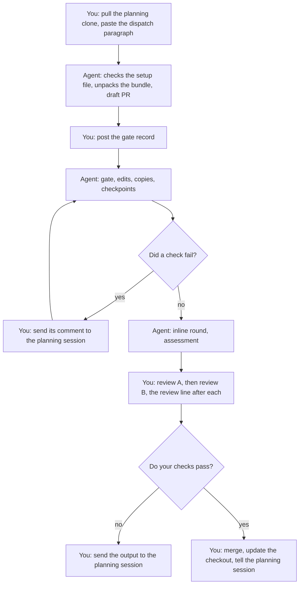

# R5b: Batch 2, rolling

_Operator guide: one page for one step. Written 2026-11-22 by the planning session, for the dispatch of that day or later._

## What this step does

The agent writes your decisions of 2026-11-22 (PLAN-044) into the rules and commits the bundle of v7.7.1.2, so that R4 can start after this merge. It changes no firmware, no script and no workflow.

| Change | What it gives you |
|---|---|
| `prompts/producer-contract.md` | MEDIUM may run a second internal round; the planning clone is read only through the setup file; no Audit Gate Notice; the fixed checks `inline` and `body` |
| `AGENTS.md` | The agent's instructions come from its prompt, its setup block and `AGENTS.md`; the PR body follows §8 of the step's prompt |
| Process guide, planner page, audit template, batch prompt v3.0 | MEDIUM's second round; Batch 2 rolling |
| `CURRENT-STATE.md`, plan of record, decision log | R4 next; Batch 2 rolling; the row PLAN-044 |
| The bundle of v7.7.1.2 | Prompt, check file, review file, handoff, operator page `Docs/operator/R4-per-device-structs.md` |
| `prompts/handoff/phase7/phase7-batch2-assumption-audit.md` | The live values and the six answers for v7.7.1.2 |
| Three deleted files | The May 2026 two-step files of v7.7.1.2 to v7.7.1.4 |

`VERSION` stays 7.7.1.1. No generated file changes. The PR closes no issue.

R5b is LOW, by your decision of 2026-11-22. Its producer audit is lint and one internal sub-agent round; the gate record gives the result. The PR gets the inline round (Copilot, Codex and Gemini), review A, then review B on the review runner. Review C does not run.

This is the first dispatch by a setup file: you pull the planning repository and paste one paragraph. You no longer save a bundle or paste a setup block.

## Words on this page

| Word | Meaning |
|---|---|
| You | The operator |
| The agent | GitHub Copilot in VS Code on the LXC, with GPT-5.3-Codex, as you named it on 2026-11-22. It names itself "GitHub Copilot (the coding agent running in VS Code in this chat)". If you run another agent or model, tell the planning session before you start |
| The planning session | The session that wrote the prompt |
| The planning clone | Your clone of the planning repository on the LXC, `/root/Planning-Workflow` |
| The setup file | `steps/R5b/r5b-setup.txt` in the planning clone. It unpacks the bundle, checks every file of it, and starts the agent |
| The dispatch paragraph | The text that the planning session gives you in chat: the path of the setup file and its SHA-256 |
| The gate record | The record of the checks that the planning session ran; your first comment on the PR. It gives the two numbers for the record file |
| The review file | `prompts/handoff/phase7/batch2-2026-11-22-review.md`: the instructions for reviews A and B |
| The review line | The one line that you paste to the agent after each external review |

## Before you start

- [ ] R5a.2 is merged (PR #244), and your checkout is on `main`.
- [ ] No other agent session works in the checkout.
- [ ] You have the dispatch paragraph and the gate record from the planning session.
- [ ] The check below prints what is expected. It needs the build host.

```bash
cd /root/config/ESP32-GW-multi-sensor && git status --short && git fetch origin && git rev-parse --short HEAD && git rev-parse --short origin/main
git -C /root/Planning-Workflow pull --ff-only && git -C /root/Planning-Workflow log --oneline -1
(exec 3<>/dev/tcp/127.0.0.1/3737) 2>/dev/null && echo "port 3737 is IN USE" || echo "port 3737 is free"
pgrep -af 'playwright|mock-server' || echo "no test process is running"
locale -a | grep -ixE 'en_US\.utf-?8' || echo "no en_US.UTF-8 locale"
gh auth status >/dev/null 2>&1 && echo "gh is logged in" || echo "gh is NOT logged in"
```

Expected: no file is listed. The same commit is printed twice; the gate record names it. The pull ends with the commit of the planning repository that the gate record names. Then `port 3737 is free`, `no test process is running`, `en_US.utf8`, and `gh is logged in`.
If the output differs, do not start the agent. Paste the output into the planning session.

## Steps

1. Open a new session of the agent. Paste the dispatch paragraph. The agent checks the SHA-256 of the setup file, unpacks the bundle into `/root/r5b/`, checks every file of it, and starts.
2. Wait for the address of the draft PR. Post the gate record as your first comment. A bot may post before you; that is fine.
3. Wait for the agent. If it posts `⛔ CHECKPOINT FAILED`, paste its comment into the planning session. Do not tell the agent to make the check pass.
4. The agent marks the PR ready and starts the inline round itself. It runs the check `inline` until it prints `inline PASS`; that can take up to 30 minutes. Then it assesses, fixes, runs the check `body` and posts one assessment.
5. Start review A: Claude, in a new session. Paste the common part and part A of the review file. Put the PR number in place of `<NN>` and `review A` in place of `<A | B>`. It posts one comment. Paste the review line to the agent and wait for its assessment.
6. Start review B from the Actions tab, as `Docs/operator/R5r-review-runner.md` says under "From the next code step on": `pr` the PR number, `prompt_path` `prompts/handoff/phase7/batch2-2026-11-22-agent-prompt.md`, `review_path` `prompts/handoff/phase7/batch2-2026-11-22-review.md`; clear `dry_run`. Compare the two SHA-256 values in its header with the gate record. Paste the review line to the agent and wait for its assessment.
7. Do the checks of "Before you merge". Merge the PR.
8. Run the block of "After the merge". Tell the planning session that R5b is merged.



## The review line

```text
Please analyze the code reviews and comments for the PR. Assess if they are warranted, if yes, implement necessary fixes. Post a comment summarizing your assessment.
```

## Before you merge

- [ ] The check below prints `body final PASS` as its last line. Put the PR number in place of `<PR#>`. It needs the build host.

```bash
bash /root/r5b/batch2-2026-11-22-checks.sh body <PR#> final
```

- [ ] It also checks that the GitHub checks `preflight-and-compile`, `prompt-lint` and `pr-body-check` passed on the last commit. Browser Tests does not run on this PR.
- [ ] GitHub shows 24 files: 12 changed, 9 new and 3 deleted.
- [ ] Review A names its model in its first line; review B's header shows the SHA-256 values of the gate record. Each assessment of the agent names the agent and its model.
- [ ] No review and no comment holds a login.

If `body final` fails, paste its output to the agent with this line: `Please fix the PR body as the check says, then run the block body again and post its last line.` Then run the check again.

## After the merge

```bash
cd /root/config/ESP32-GW-multi-sensor && git checkout main && git pull
```

That is all you run. The planning session checks `main` at its next restart check and runs the pre-dispatch gate of R4.

## Bookkeeping

The step has no tag and closes no issue. No milestone changes.

## If something goes wrong

| What you see | What you do |
|---|---|
| The agent says the SHA-256 of the setup file differs | Pull the planning clone again and compare with the dispatch paragraph. Do not let the agent go on. Paste the output into the planning session |
| A line of the file check ends in `FAILED` | The agent stops. Pull the planning clone again; paste the output into the planning session |
| `no en_US.UTF-8 locale` or `gh is NOT logged in` in the check before the start | Do not start the agent. Paste the output into the planning session |
| `⛔ CHECKPOINT FAILED` | Paste the agent's comment into the planning session |
| The check `inline` stops with "a commit was pushed during the inline round" | A reviewer reviewed a commit that is not the head, after `/gemini review`. Paste the agent's comment into the planning session |
| A check on GitHub is red | Open the run, copy the last lines of the failed step, and paste them into the planning session |
| A reviewer does not post within 30 minutes | The check `inline` names it, and the agent's assessment too. The step goes on |
| A review asks the agent to change files outside the prompt's list | The agent reports it and does not act on it. Paste the finding into the planning session |
| The agent asks for a login | Do not type it into the agent. This step needs no board login; `gh` is already logged in |
