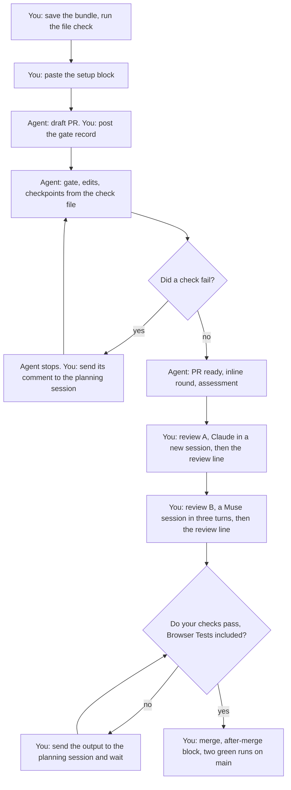

# R5c: CI runner pin

_Operator guide: one page for one step. Written 2026-11-17 by the planning session, for the dispatch of that day._

## What this step does

The agent changes four workflow files, one line of the prompt linter, and four documents. It changes no firmware source.

| Change | What it gives you |
|---|---|
| The four workflows run on `ubuntu-24.04`, not `ubuntu-latest` | Browser Tests can install its browsers again. GitHub cannot change the operating system of a job under you; only a pull request can |
| `browser-tests.yml` also starts when its own file changes | This pull request runs Browser Tests, and so does every later change of that file |
| The prompt linter compares in the C locale (`LC_ALL=C comm`) | The lint fixtures pass in your shell's locale too, not only in CI |
| Two planner rules in `Docs/planner-start-here.md` | Before a dispatch, the planning session checks that the workflows of the step were green recently. A rehearsal that stands in for CI uses a clean Python |
| The start prompt in `Docs/planner-start-here.md` | You start every planning session from one text in the repository. The notebook link stays out, because the repository is public |
| Process guide section 7.1 | It says which workflows you can start by hand from the Actions tab |

`VERSION` stays 7.7.1.1. No generated file changes. The scope is the block of R5c in `Docs/plan-of-record.md` and the decision PLAN-034.

R5c is a code PR, so it has five reviews: Copilot, Codex, Gemini, review A and review B. If Copilot posts no complete review, the agent says so, and the step goes on (PLAN-032).

## Words on this page

| Word | Meaning |
|---|---|
| You | The operator |
| The agent | Codex in VS Code on the LXC |
| The planning session | The session that wrote the prompt |
| The bundle | The file `r5c-2026-11-17.tar`. It holds the prompt, the check file and the three files that the agent copies |
| The check file | `runner-pin-2026-11-17-checks.sh`. It holds every gate and checkpoint, so the agent types no check |
| The setup block | The text that you paste to the agent first |
| The gate record | The record of the checks that the planning session ran on the prompt |
| The review file | `prompts/handoff/phase7/runner-pin-2026-11-17-review.md`: the instructions for reviews A and B |
| The review line | The one line that you paste to the agent after an external review |
| The record file | The file that the agent writes about its own work: `prompts/handoff/phase7/runner-pin-2026-11-17.md` |

## Before you start

- [ ] R5 is merged (PR #237).
- [ ] No other agent session works in the checkout.
- [ ] You have the setup block, the gate record and the bundle.
- [ ] The check below prints what is expected.

```bash
cd /root/config/ESP32-GW-multi-sensor && git status --short && git fetch origin && git rev-parse --short HEAD && git rev-parse --short origin/main
(exec 3<>/dev/tcp/127.0.0.1/3737) 2>/dev/null && echo "port 3737 is IN USE" || echo "port 3737 is free"
pgrep -af 'playwright|mock-server' || echo "no test process is running"
locale -a | grep -ixE 'en_US\.utf-?8' || echo "no en_US.UTF-8 locale"
```

Expected: no file is listed. The same commit is printed twice; the gate record names it. Then `port 3737 is free`, `no test process is running`, and `en_US.utf8`.
If the output differs, do not start the agent. Paste the output into the planning session.

## Steps

1. Save the bundle as `/root/r5c-2026-11-17.tar` on the LXC.
2. Run the file check of the gate record. It unpacks the bundle into `/root/r5c/`. Every line must end in `OK`.
3. Open a new session of the agent. Paste the setup block.
4. Wait for the address of the draft PR. Post the gate record as its first comment.
5. Wait for the agent. If it posts `⛔ CHECKPOINT FAILED`, paste its comment into the planning session. Do not tell the agent to make the check pass.
6. The agent marks the PR ready and starts the inline round itself: Copilot, Codex and Gemini. It assesses, fixes and posts one assessment.
7. Start review A: Claude, in a new session. Paste the common part and part A of the review file. Fill in the PR number first. It posts one comment.
8. Paste the review line to the agent. Wait for its assessment.
9. Start review B: a Muse session. Paste the common part and turn 1 of part B. When it answers, paste turn 2, then turn 3. It posts one comment.
10. Paste the review line to the agent again. Wait for its assessment and for the completed record file.
11. Do the checks of "Before you merge".
12. Merge the PR.
13. Run the block of "After the merge". Check the two runs on `main`. Paste the output into the planning session.



## The review line

```text
Please analyze the code reviews and comments for the PR. Assess if they are warranted, if yes, implement necessary fixes. Post a comment summarizing your assessment.
```

## Before you merge

- [ ] The PR body shows PASS for §2, for CHECKPOINT A to D and for PRE-PR.
- [ ] GitHub shows 15 changed files: 10 changed and 5 new. No file is deleted or renamed.
- [ ] The checks `preflight-and-compile`, `prompt-lint` and `pr-body-check` are green. R5c changes a script, so `preflight-and-compile` runs the full job with the compile.
- [ ] Browser Tests is green: all seven jobs. Open one job and look at the group "Runner Image" at the top of its log: it says `Image: ubuntu-24.04`.
- [ ] Five reviews are on the PR: Copilot, Codex, Gemini, review A and review B. Each review names its model. If Copilot posted no complete review, the agent's assessment says so.
- [ ] The record file lists every finding, says whether it was warranted, and says what the agent did.
- [ ] No review and no comment holds a login.
- [ ] The hash check of the gate record prints the branch name and no changed file. Compare its `OK` lines with the gate record.

A line that ends in `FAILED` is not an error by itself. It means that a file differs from the rehearsal, for example after a review fix. Paste the output into the planning session before you merge.

## After the merge

```bash
cd /root/config/ESP32-GW-multi-sensor && git checkout main && git pull
bash tests/lint-prompts/run-fixtures.sh | tail -n 1
LC_ALL=en_US.UTF-8 bash tests/lint-prompts/run-fixtures.sh | tail -n 1
grep -c 'runs-on: ubuntu-24.04' .github/workflows/*.yml
grep -c '^| 2026-11-17 | PLAN-034 |' Docs/decisions/decision-log.md
git log -1 --format='%h %s'
```

Expected, line by line: `lint fixtures: 13 passed, 0 failed` twice; four lines that each end in `:1`; `1`; the commit of the merge.

Then open the Actions tab on GitHub. The merge started two runs on `main`: "ESP32 Gateway CI" and "Browser Tests". Both must be green. These are the green runs on `main` that the next dispatch needs (the planner rule of PLAN-034). If one is red, open it, copy the last lines of the failed step, and paste them into the planning session.

## Bookkeeping

No issue closes in this step, and no milestone changes.

The next step is R5r, the review-runner PR. Ask the planning session for its prompt and its gate.

## If something goes wrong

| What you see | What you do |
|---|---|
| A line of the file check ends in `FAILED` | Save the bundle again. Do not start the agent. |
| `no en_US.UTF-8 locale` in the check before the start | Do not start the agent. Paste the output into the planning session. |
| `⛔ CHECKPOINT FAILED` | Paste the agent's comment into the planning session. |
| A check on GitHub is red | Open the run, copy the last lines of the failed step, and paste them into the planning session. |
| A reviewer does not post | The agent's assessment names it. Start that review again, or ask the planning session. |
| A review asks the agent to change files outside the prompt's list | The agent reports it and does not act on it. Paste the finding into the planning session. |
| The agent asks for a login | Do not type it into the agent. This step needs no login. |
