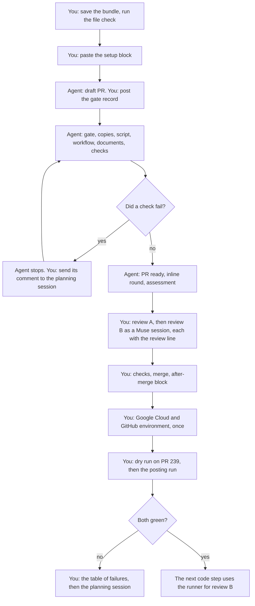

# R5r: the review runner

_Operator guide: one page for one step. Written 2026-11-17 by the planning session and reconciled with audit rounds 1 to 3 on 2026-11-18. The sections "Set up Google Cloud", "Set up the GitHub environment", "Run review B" and "Add a profile" stay valid after this step; the workflow points here._

## What this step does

The agent adds a review runner: a workflow that you start by hand, which runs review B on a Gemini model and posts one comment. It also changes the documents that state the reviews, and it moves the planning notes to their private repository in the documents.

| Change | What it gives you |
|---|---|
| `.github/workflows/external-review.yml` and `scripts/external-review.py` | Review B in three turns, started by you from the Actions tab, with no key stored anywhere |
| `Docs/templates/external-review-template.md` | The fixed text of the three turns. A change of it is a pull request |
| `tests/external-review/test_external_review.py` | 31 tests of the runner with stubs. No Google account is needed to run them |
| Process guide §2.4, the plan of record, two templates | Reviews A and C side by side, then review B by the runner (PLAN-023) |
| `Docs/planner-start-here.md` | The start prompt names the planning repository (PLAN-035); who audits a MEDIUM or HIGH prompt (PLAN-037); the rules from the audit of R5r |

`VERSION` stays 7.7.1.1. R5r is a MEDIUM code PR that changes no firmware, so review C is optional and does not run (PLAN-036). It has five reviews: Copilot, Codex, Gemini, review A (Claude) and review B. The runner cannot review the PR that installs it, so review B of this PR is a Muse session in three turns. If Copilot posts no complete review, the agent says so, and the step goes on (PLAN-032).

## Words on this page

| Word | Meaning |
|---|---|
| You | The operator |
| The agent | Codex in VS Code on the LXC |
| The runner | The workflow "External Review" and its script |
| A profile | One Google Cloud project that the runner can bill, as variables of the GitHub environment `external-review` |
| The bundle | The file `r5r-2026-11-17.tar`: the prompt, the check file and the seven files that the agent copies |
| The check file | `review-runner-2026-11-17-checks.sh`. It holds every gate and checkpoint |
| The setup block | The text that you paste to the agent first |
| The gate record | The record of the checks that the planning session ran on the prompt, with the audit |
| The review file | `prompts/handoff/phase7/review-runner-2026-11-17-review.md`: the instructions for reviews A and B of this PR |
| The review line | The one line that you paste to the agent after an external review |

## Before you start

- [ ] R5c is merged (PR #239).
- [ ] The independent audit of the prompt is done and reconciled; the gate record says so.
- [ ] No other agent session works in the checkout.
- [ ] You have the setup block, the gate record and the bundle.
- [ ] The check below prints what is expected.

```bash
cd /root/config/ESP32-GW-multi-sensor && git status --short && git fetch origin && git rev-parse --short HEAD && git rev-parse --short origin/main
(exec 3<>/dev/tcp/127.0.0.1/3737) 2>/dev/null && echo "port 3737 is IN USE" || echo "port 3737 is free"
pgrep -af 'playwright|mock-server' || echo "no test process is running"
python3 -c 'import sys; print("python ok" if sys.version_info >= (3, 12) else "python too old")'
```

Expected: no file is listed. The same commit is printed twice; the gate record names it. Then `port 3737 is free`, `no test process is running` and `python ok`.
If the output differs, do not start the agent. Paste the output into the planning session.

You may do the two setup sections below at any time before the dry run. They change nothing in the repository.

## Steps

1. Save the bundle as `/root/r5r-2026-11-17.tar` on the LXC.
2. Run the file check of the gate record. It unpacks the bundle into `/root/r5r/`. Every line must end in `OK`.
3. Open a new session of the agent. Paste the setup block.
4. Wait for the address of the draft PR. Post the gate record as its first comment.
5. Wait for the agent. If it posts `⛔ CHECKPOINT FAILED`, paste its comment into the planning session. Do not tell the agent to make the check pass.
6. The agent marks the PR ready and starts the inline round itself. It assesses, fixes and posts one assessment.
7. Start review A: Claude, in a new session. Paste the common part and part A of the review file, with the PR number filled in.
8. Paste the review line to the agent. Wait for its assessment.
9. Start review B: a Muse session. Paste the common part and turn 1 of part B. When it answers, paste turn 2, then turn 3.
10. Post one PR comment with the two numbers of §8 of the record file: producer sessions and audit sessions for this step's prompt (the gate record proposes them). Then paste the review line to the agent again. Wait for its assessment and for the completed record file.
11. Do the checks of "Before you merge". Merge the PR.
12. Run the block of "After the merge".
13. Set up Google Cloud and the GitHub environment, if you have not done it yet.
14. Do the dry run, then the posting run. Paste both results into the planning session.



## The review line

```text
Please analyze the code reviews and comments for the PR. Assess if they are warranted, if yes, implement necessary fixes. Post a comment summarizing your assessment.
```

## Before you merge

- [ ] The PR body shows PASS for §2, for CHECKPOINT A to D and for PRE-PR.
- [ ] GitHub shows 17 changed files: 7 changed and 10 new. No file is deleted or renamed.
- [ ] The checks `preflight-and-compile`, `prompt-lint`, `pr-body-check` and Browser Tests are green. R5r adds a script and tests, so `preflight-and-compile` runs the full job.
- [ ] Five reviewers were asked: Copilot, Codex, Gemini, review A and review B. Each review that posted names its model. If Copilot posted no complete review, the agent's assessment says so, and the step goes on (PLAN-032).
- [ ] The last `PRE-PR PASS at <commit>` in the PR body names the head of the PR.
- [ ] The record file has its review findings in §3, its Prompt Quality Score in §5, and numbers, not `pending`, in §8 (you give the first two numbers to the agent).
- [ ] The record file lists every finding, its assessment and what was done; its §4 lists the design choices of the agent.
- [ ] No file, review or comment holds a login, a token, or a real project ID, provider name or service account.
- [ ] The hash check of the gate record prints the branch name and no changed file. Compare its `OK` lines with the gate record. A `FAILED` line means that a file differs from the rehearsal; paste the output into the planning session before you merge.

## After the merge

```bash
cd /root/config/ESP32-GW-multi-sensor && git checkout main && git pull
python3 -I tests/external-review/test_external_review.py 2>&1 | tail -n 3
grep -c '^| 2026-11-1[78] | PLAN-03[567] |' Docs/decisions/decision-log.md
git log -1 --format='%h %s'
```

Expected, line by line: `Ran 31 tests in` and a time, an empty line, `OK`; `3`; the commit of the merge.

## Set up Google Cloud (once)

The planning session checked the flags of every command below against `gcloud --help` and the command forms against Google's pages (`google-github-actions/auth` README; Workload Identity Federation with deployment pipelines). The gate record names the `gcloud` version. It could not run them: it has no access to your Google Cloud. Your account needs the Owner role on the project, or roles that let it turn on APIs, manage Workload Identity pools and change the project's IAM policy. Run them one at a time in a shell where `gcloud` is logged in to your account; that shell is not the LXC's agent session. Each step gives the command, the same in the console, and the expected result. If a result differs, stop and paste it into the planning session.

First set two shell variables. Replace `your-project-id` with the ID of the project that pays for the reviews.

```bash
PROJECT_ID="your-project-id"
REPO="GCV-Sleeper-Service/ESP32-GW-multi-sensor"
```

**G1. Check that billing is on.** The project must have an active billing account. The command shows only that. Whether credits pay for the runs is on the Credits page of that billing account (Billing, then Credits): check their balance, their dates and the services they cover.

```bash
gcloud billing projects describe "${PROJECT_ID}" --format="value(billingEnabled)"
```

Console: Billing, then "My projects"; the project shows a billing account. Expected: `True`.

**G2. Turn on five APIs.** Agent Platform (the model); IAM, Resource Manager, IAM Service Account Credentials and Security Token Service (the sign-in; Google's page on federation for deployment pipelines lists these four).

```bash
gcloud services enable aiplatform.googleapis.com iam.googleapis.com cloudresourcemanager.googleapis.com iamcredentials.googleapis.com sts.googleapis.com --project="${PROJECT_ID}"
```

Console: APIs & Services, then Library; search each name (`aiplatform.googleapis.com` is listed as Vertex AI API or Agent Platform API; `cloudresourcemanager.googleapis.com` as Cloud Resource Manager API) and click Enable. Expected: the command ends without an error; in the console each API shows "API enabled".

**G3. Create a Workload Identity Pool.** The pool is where GitHub's short-lived identity tokens are accepted. Nothing in it is a key. The pool `github` holds only the provider of G4: G5 gives the role to every identity of this repository in the pool, so never add another provider to it.

```bash
gcloud iam workload-identity-pools create "github" --project="${PROJECT_ID}" --location="global" --display-name="GitHub Actions Pool"
```

Console: IAM & Admin, then Workload Identity Federation, then Create pool; name `github`. Expected: `Created workload identity pool [github].`

**G4. Create the provider for this repository.** It accepts a token only from this repository, named and identified by its number and its owner's number, from the workflow file `.github/workflows/external-review.yml` on `refs/heads/main`, from the environment `external-review`, started by `workflow_dispatch`. The two numbers are public. Check them first:

```bash
curl -sS https://api.github.com/repos/GCV-Sleeper-Service/ESP32-GW-multi-sensor | python3 -c 'import json,sys; d=json.load(sys.stdin); print(d["id"], d["owner"]["id"])'
```

Expected: `1175508662 45667495`. If it differs, stop and paste it into the planning session. Google accepts a claim in the condition only when the mapping maps it, so the mapping below maps all seven claims that the condition uses.

```bash
gcloud iam workload-identity-pools providers create-oidc "esp32-gw-review" --project="${PROJECT_ID}" --location="global" --workload-identity-pool="github" --display-name="ESP32-GW review runner" --issuer-uri="https://token.actions.githubusercontent.com" --attribute-mapping="google.subject=assertion.sub,attribute.repository=assertion.repository,attribute.environment=assertion.environment,attribute.ref=assertion.ref,attribute.event_name=assertion.event_name,attribute.repository_id=assertion.repository_id,attribute.repository_owner_id=assertion.repository_owner_id,attribute.workflow_ref=assertion.workflow_ref" --attribute-condition="assertion.repository == '${REPO}' && assertion.repository_id == '1175508662' && assertion.repository_owner_id == '45667495' && assertion.workflow_ref == '${REPO}/.github/workflows/external-review.yml@refs/heads/main' && assertion.environment == 'external-review' && assertion.ref == 'refs/heads/main' && assertion.event_name == 'workflow_dispatch'"
```

Console: in the pool `github`, Add provider; type OpenID Connect (OIDC); name `esp32-gw-review`; issuer URL `https://token.actions.githubusercontent.com`; audiences: default; attribute mapping: `google.subject` = `assertion.sub`, `attribute.repository` = `assertion.repository`, `attribute.environment` = `assertion.environment`, `attribute.ref` = `assertion.ref`, `attribute.event_name` = `assertion.event_name`, `attribute.repository_id` = `assertion.repository_id`, `attribute.repository_owner_id` = `assertion.repository_owner_id`, `attribute.workflow_ref` = `assertion.workflow_ref`; attribute condition: the text after `--attribute-condition=` above, with `${REPO}` written out. Expected: `Created workload identity pool provider [esp32-gw-review].`

**G5. Let the repository's runs call the model.** The role `roles/aiplatform.user` goes to every identity of this repository in the pool.

```bash
POOL="$(gcloud iam workload-identity-pools describe "github" --project="${PROJECT_ID}" --location="global" --format="value(name)")"
echo "${POOL}"
gcloud projects add-iam-policy-binding "${PROJECT_ID}" --role="roles/aiplatform.user" --member="principalSet://iam.googleapis.com/${POOL}/attribute.repository/${REPO}" --condition=None
```

Console: IAM & Admin, then IAM, then Grant access; new principal `principalSet://iam.googleapis.com/projects/<project number>/locations/global/workloadIdentityPools/github/attribute.repository/GCV-Sleeper-Service/ESP32-GW-multi-sensor`; role ID `roles/aiplatform.user`. Expected: `echo` prints `projects/<project number>/locations/global/workloadIdentityPools/github`; the binding command prints the new policy and names that member. A new role can take some minutes to take effect.

**G6. Read the provider name for GitHub.**

```bash
gcloud iam workload-identity-pools providers describe "esp32-gw-review" --project="${PROJECT_ID}" --location="global" --workload-identity-pool="github" --format="value(name)"
```

Console: the provider's page shows its full name. Expected: `projects/<project number>/locations/global/workloadIdentityPools/github/providers/esp32-gw-review`. Keep it for the next section. It is not a secret, but it stays out of the repository.

## Set up the GitHub environment (once)

1. On GitHub, open the repository. Click **Settings**, then **Environments**, then **New environment**. Name: `external-review`. Click **Configure environment**.
2. Under **Deployment branches and tags**, choose **Selected branches and tags**, then **Add deployment branch or tag rule**: ref type Branch, name pattern `main`. Save.
3. Under **Environment variables**, click **Add environment variable** twice:
   - `GCP_PROJECT_ID_DEFAULT` = your project ID
   - `GCP_WIF_PROVIDER_DEFAULT` = the provider name of G6
4. Add no secret. Add `GCP_SERVICE_ACCOUNT_DEFAULT` only if the table below tells you to.

Expected: the environment page shows one branch rule, `main`, and two variables.

Only people with write access to the repository can start the workflow, and each run is billed to your project. If anyone besides you gets write access, add yourself under **Required reviewers** of the environment, so that every run waits for your approval.

What a run shows in its log, which is public in this repository: the profile name; the project ID, provider name and service account of the chosen profile (the steps "Select profile" and "Sign in to Google Cloud" print them); the inputs of the run. They are not secrets (PLAN-036). The runner never prints the GitHub token or a Google access token, and no other variable of the environment is passed to a step.

## Run review B

From the next code step on, this is how you start review B (PLAN-023). It needs the PR number, the path of the step's agent prompt and the path of its review file.

1. On GitHub, click **Actions**, then **External Review**, then **Run workflow**.
2. "Use workflow from": Branch `main`. Fill in `pr`, `prompt_path` and `review_path`. Keep `model` at `gemini-4-hydrogen`, `thinking_level` at `HIGH` and `profile` at `default`, unless you have a reason. `XHIGH` works with `gemini-4-hydrogen` only; the runner refuses it for the other two. Clear `dry_run` to post the review.
3. Click **Run workflow**. A run takes a few minutes. When it is green, the PR has one comment by `github-actions[bot]`. Before you use the review, compare the SHA-256 of the agent prompt and of the review file in its header with the gate record of the step.
4. Paste the review line to the agent.

## Dry run (after the merge)

Run review B as above with these values: `pr` `239`; `prompt_path` `prompts/handoff/phase7/runner-pin-2026-11-17-agent-prompt.md`; `review_path` `prompts/handoff/phase7/runner-pin-2026-11-17-review.md`; `dry_run` checked. PR #239 is R5c. The planning session scanned its diff, body, reviews and comments with rule L11 and found no login literal; PR #235 is not used, because its diff holds deleted login literals.

Expected: the run is green; its summary starts with the line `## Review B - runner: gemini-4-hydrogen, thinking HIGH (dry run)`; the header table shows ``| Pull request | #239, head `eb15ca46899445d83513c4f137b6a71ad705c968`, base `main` at `1a7bf844cc4fc00fed15122733fdb03185b9a202` |``, the agent prompt with SHA-256 `0e41fbd2f0d8476771773141845b1fef526f86758cbb55b4f18f5d9dafdfff28`, the review file with SHA-256 `aa6c19547a550020d7314a91219db70bb4f459eb83ae51e931b7166e334e1dc4`, and `| Generated files left out | none |`; the summary holds `### Turn 1`, `### Turn 2` and `### Turn 3`; PR #239 gets no new comment. Paste the header table of the summary into the planning session.

## Posting run (after the dry run)

Run it once more with the same values and `dry_run` cleared. Expected: the run is green, and PR #239 has one new comment by `github-actions[bot]` whose first line is `## Review B - runner: gemini-4-hydrogen, thinking HIGH`. If the run ends with `unknown whether the comment was posted`, look at the PR before you run it again. This proves that the job's token may post. Paste the address of the comment into the planning session.

## If a run fails

| What the log or the run page says | The likely cause | What you do |
|---|---|---|
| The run page says "Waiting for review" | The environment has required reviewers | Approve the run on its page |
| The job `review` is skipped and the run has no summary | The run was started from a branch other than `main` | Start it again with branch `main` |
| The run stops before its first step: `main` may not deploy to `external-review` | The branch rule of the environment does not name `main` | Check step 2 of "Set up the GitHub environment" |
| Step "Select profile": "no GCP_PROJECT_ID_DEFAULT or no GCP_WIF_PROVIDER_DEFAULT" | The variables are missing | Add them, as in the section above |
| Step "Sign in to Google Cloud": `unauthorized_client` or "rejected by the attribute condition" | The token's claims differ from the condition of G4 | Do not change the condition. Paste the log lines into the planning session |
| `gcloud auth print-access-token failed` | The sign-in did not reach `gcloud` | Paste the log lines into the planning session |
| `the model call of turn 1 failed: HTTP 403` | An API of G2 is off, billing is off (G1), G5 is missing or not yet in effect, or Agent Platform refuses the federated identity | Check G1, G2 and G5. Wait ten minutes after G5 and run again. If it still fails, set up the service account below and add `GCP_SERVICE_ACCOUNT_DEFAULT` |
| `the model call of turn <n> failed: HTTP 404` | The model is not served to the project | Paste the log lines into the planning session |
| `the model call of turn <n> failed: HTTP 429` | A quota of Agent Platform is used up | Run again later; if it stays, paste it into the planning session |
| `the model stopped with MAX_TOKENS` | The answer and its thinking did not fit; on Argon and Carbon a request of this kind gets at most 32,768 output tokens, thinking included (Google's model pages) | Run again with `gemini-4-hydrogen`, or at a lower thinking level |
| `GitHub GET ...: HTTP 403` or `HTTP 404` | A wrong PR number or path, or the job's token may not read | Check `pr`, `prompt_path` and `review_path`, then paste the line into the planning session. This is not a Google problem: change nothing in Google Cloud |
| `GitHub POST .../comments: HTTP 403` | The job's token may not post a comment. GitHub's permission table lists `pull-requests: write` as enough | Check that the run started from `main`, then paste the line into the planning session. This is not a Google problem: change nothing in Google Cloud |
| `unknown whether the comment was posted` | GitHub gave no answer to the post | Look at the PR. If the comment is there, the run did its work; if not, run it again |
| `the pull request moved` | Someone pushed to the PR, or changed its base, during the run | Run it again |
| `redirect`, `already read` or `next` | GitHub or Google answered in an unexpected way | Paste the line into the planning session; do not run it again |
| `refused: ... exceeds the limit` | The PR's data is too large for one review. The login check runs first, on the whole diff with the generated files, so the data holds no login literal | Paste it into the planning session. You may run review B as a Muse session meanwhile, or wait (PLAN-023) |
| `refused: ... login literal` | The PR's data holds a login, perhaps on a deleted line | Run no review B on it, by the runner or by Muse. Paste the refusal line (it names the block and the line, not the value) into the planning session |
| `failed: ... login literal` | An answer of the model looks like a login | Nothing was posted. Paste the line into the planning session |
| `the comment is too long` | Turn 3 is longer than a comment may be | The review is in the run summary; paste it into the planning session |
| `too long for the run summary` | The three answers are longer than a run summary may be | Run again at a lower thinking level, or paste the line into the planning session |
| The run stops after 60 minutes, with no line of the runner | GitHub or Google answered very slowly | Look at the PR for a new comment; run it again later, and paste it into the planning session if it repeats |

The service account without a key (only when the table says so). Set the variables first; this may be a new shell.

```bash
PROJECT_ID="your-project-id"
REPO="GCV-Sleeper-Service/ESP32-GW-multi-sensor"
POOL="$(gcloud iam workload-identity-pools describe "github" --project="${PROJECT_ID}" --location="global" --format="value(name)")"
echo "${POOL}"
gcloud iam service-accounts create "esp32-gw-review" --project="${PROJECT_ID}" --display-name="ESP32-GW review runner"
gcloud projects add-iam-policy-binding "${PROJECT_ID}" --role="roles/aiplatform.user" --member="serviceAccount:esp32-gw-review@${PROJECT_ID}.iam.gserviceaccount.com" --condition=None
gcloud iam service-accounts add-iam-policy-binding "esp32-gw-review@${PROJECT_ID}.iam.gserviceaccount.com" --project="${PROJECT_ID}" --role="roles/iam.workloadIdentityUser" --member="principalSet://iam.googleapis.com/${POOL}/attribute.repository/${REPO}" --condition=None
```

Then add the environment variable `GCP_SERVICE_ACCOUNT_DEFAULT` = `esp32-gw-review@<your project id>.iam.gserviceaccount.com`. No key file is created, and none may be. Console: IAM & Admin, then Service Accounts, Create; then IAM, Grant access, role ID `roles/aiplatform.user`; then the service account's Permissions tab, Grant access to the principal set with role ID `roles/iam.workloadIdentityUser`. Expected: `echo` prints the pool name of G5; each command ends without an error; the next dry run is green.

## Add a profile

A profile lets the runner bill another Google Cloud project. Before you rely on credits of another Google account's subscription, ask the planning session to check Google's terms first (plan of record, R5r).

1. Pick a name: lower-case letters, digits and `_`, starting with a letter, at most 20 characters, for example `second`. The variables use it in upper case: `SECOND`.
2. In the new project, do G1 and G2. Then grant the role to the same principal set of the pool in your first project. Set the variables first; this may be a new shell:

   ```bash
   PROJECT_ID="your-project-id"
   NEW_PROJECT_ID="your-second-project-id"
   REPO="GCV-Sleeper-Service/ESP32-GW-multi-sensor"
   POOL="$(gcloud iam workload-identity-pools describe "github" --project="${PROJECT_ID}" --location="global" --format="value(name)")"
   echo "${POOL}"
   gcloud projects add-iam-policy-binding "${NEW_PROJECT_ID}" --role="roles/aiplatform.user" --member="principalSet://iam.googleapis.com/${POOL}/attribute.repository/${REPO}" --condition=None
   ```

   Expected: `echo` prints the pool name of G5; the new policy names that member. If your first profile uses the service account of the table above, grant `roles/aiplatform.user` on the new project to that service account instead (`--member="serviceAccount:esp32-gw-review@${PROJECT_ID}.iam.gserviceaccount.com"`).
3. In the GitHub environment `external-review`, add `GCP_PROJECT_ID_SECOND` = the new project ID and `GCP_WIF_PROVIDER_SECOND` = the same provider name as `GCP_WIF_PROVIDER_DEFAULT`. If the first profile uses the service account, add `GCP_SERVICE_ACCOUNT_SECOND` = the same service account.
4. Ask the planning session for a small pull request that adds the name to the `profile` options of `.github/workflows/external-review.yml` and a clause for it to each of the three expressions of the step "Select profile", for example `${{ inputs.profile == 'default' && vars.GCP_PROJECT_ID_DEFAULT || inputs.profile == 'second' && vars.GCP_PROJECT_ID_SECOND || '' }}`. The workflow lives on `main`, so a new profile always goes through a review.
5. Do a dry run with the new profile.

## Cost

Estimate, not a measurement. Each turn sends the whole conversation again, so the data of turn 1 is read three times and the data of turn 2 twice. A typical review reads about 250,000 input tokens and writes about 30,000 output tokens, thinking included, over its three turns. Prices per 1M tokens on Google's Gemini API pricing page, read on 2026-11-18: Gemini 4 Hydrogen $1.50 input and $7.50 output; Gemini 4 Argon and Carbon $2 and $10 until 2026-11-30, then $4 and $20. That makes about $0.60 for Hydrogen and about $0.80 for Argon or Carbon, $1.60 from December. A larger PR costs more. Agent Platform's own price page could not be read; it may differ. The header of every run shows the real token counts.

## Bookkeeping

No issue closes in this step, and no milestone changes. The next step is R5a, the producer contract, a documentation PR that does not wait for the runner; ask the planning session for its prompt and its gate. The dry run and the posting run come before the next code step.

## If something goes wrong

| What you see | What you do |
|---|---|
| A line of the file check ends in `FAILED` | Save the bundle again. Do not start the agent. |
| `⛔ CHECKPOINT FAILED` | Paste the agent's comment into the planning session. |
| A check on GitHub is red | Open the run, copy the last lines of the failed step, and paste them into the planning session. |
| A reviewer does not post | The agent's assessment names it. Start that review again, or ask the planning session. |
| A review asks the agent to change files outside the prompt's list | The agent reports it and does not act on it. Paste the finding into the planning session. |
| The agent asks for a login, a project ID or a provider name | Do not give it. This step needs none of them. |
