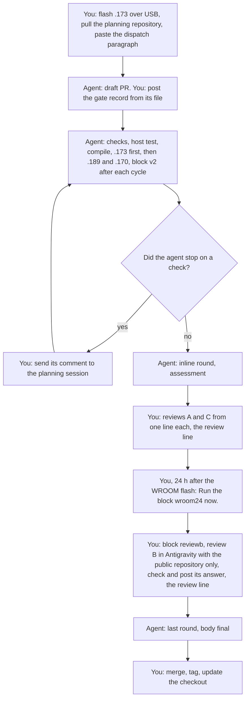

# R6: v7.7.1.3, per-device persist write path

_Operator guide: one page for one step. Written 2026-11-24 by the planning session for R6 (PLAN-044, PLAN-046); corrected 2026-11-25 after GPT Astra's audit (PLAN-047)._

## What this step does

Every hour, at minute 10, the boards save the last hour of history to flash. From this step on they save it twice: as before, and also once per device, in the new format of Phase 7 ("dual-write"). Nothing reads the new copies yet; the next step, v7.7.1.4, restores from them at boot. The agent flashes the test board .173 first, then the C3 (.189) and the WROOM (.170).

| Change | What it gives you |
|---|---|
| `firmware/core/nvs-persistence.h` | The new write path: one blob per device per hour, in a ring of 24 hours per device |
| `firmware/core/web-handler.h` | `/api/storage-stats` shows each device's ring under `persist_v2` |
| The C3 YAML and the generator | The hourly job calls the new write path after the old one |
| Five config files | The new MAC of the sensor "outside" |
| Version files and generated files | v7.7.1.3 everywhere |
| `CURRENT-STATE.md`, plan of record, changelog, session log, record | The documents of the step |
| The texts of PLAN-046 and PLAN-047: this page, the review file, the audit file, the handoff, the assumption audit, the process guide, the producer contract, the audit template, the template of the record, the plan of record, the decision log and the planner's start page | Your decisions of 2026-11-24 |

The step is MEDIUM (PLAN-044). The PR gets the inline round (Copilot and Gemini), reviews A and C, then review B in Google Antigravity with Gemini 4 Neon (PLAN-047). Each review reads its part of the review file from the PR, from one line that you give it. It closes issue #215.

Safety rules of the step (PLAN-046):
- A device's ring has 24 slots (one day). The plan of May 2026 had 360; that would fill the history partition in about 5 days and stop the old history too.
- The new write is skipped when the history partition has fewer than 252 free entries, so the old history always has room.
- The step stops if the WROOM's `min_free_heap` is below 1,024 B at any reading, before or after its upload. The new flash keys take about 1.0 to 1.5 KB of the WROOM's heap once the rings are full, and its lowest reading so far is 2,252 B, so a stop at the 24-hour reading is possible. That is what the floor is for.
- A firmware image above 95 % of its OTA slot stops the step; above 90 % the block says so (PLAN-047). The images of this step are at about 72 % to 82 %.

## Words on this page

| Word | Meaning |
|---|---|
| You | The operator |
| The agent | The coding agent on the LXC, with the harness and the model that the gate record names |
| The planning session | The session that wrote and checks the prompt |
| The setup file | `/root/Planning-Workflow/steps/R6/r6-setup.txt`: the file that starts the agent |
| The dispatch paragraph | The text that the planning session gives you in chat: the path of the setup file and its SHA-256 |
| The gate record | `/root/Planning-Workflow/steps/R6/r6-gate-record.md`: the record of the checks that the planning session ran on the prompt; your first comment on the PR |
| The review line | The one line that you paste to the agent after each external review |
| A persist cycle | The hourly save at minute 10 |

## Before you start

- [x] **.173 flashed over USB with v7.7.1.2 and the project's partition table: done on 2026-11-24.** .173 ran an older ESPHome partition table without a history partition (`history_bytes` 0), and OTA never changes the partition table; only a USB flash does. Its USB port is the chip's own USB-Serial/JTAG port (`/dev/ttyACM*`): esptool reaches it only with `--before usb-reset`; without it, esptool stops with `Wrong boot mode detected (0x28)! The chip needs to be in download mode.` The flash writes `firmware.factory.bin` at address 0x0: the bootloader, the partition table and the app in one image. These commands worked, with the board's port in place of `<TTY>` (on 2026-11-24 `/dev/ttyACM2`):

```bash
cd /root/config/ESP32-GW-multi-sensor && git status --short && git checkout main && git pull --ff-only
cp config/gateway-sat-s3-4m-173.json.bak config/gateway.json
python3 scripts/render_sensor_config.py --write
esphome compile firmware/esp32-s3-supermini-4m-gw.yaml
esptool --port <TTY> --before usb-reset erase-flash
esptool --chip esp32s3 --port <TTY> --before usb-reset write-flash 0x0 /root/config/ESP32-GW-multi-sensor/firmware/.esphome/build/sat-s3-4m-173/.pioenvs/sat-s3-4m-173/firmware.factory.bin
esphome clean firmware/esp32-s3-supermini-4m-gw.yaml
bash scripts/provision.sh satellite
git status --short
```

Result on 2026-11-24: `Flash memory erased successfully`; `Hash of data verified.`; `git status --short` printed nothing; the check below printed `history_bytes 524288 nvs available True`; `fleet` showed .173 on v7.7.1.2.

```bash
curl -s http://192.168.120.173/api/storage-stats | python3 -c 'import json,sys; d=json.load(sys.stdin); print("history_bytes", d["layout"]["history_bytes"], "nvs available", d["nvs_stats"]["available"])'
```

- [ ] You ran `fleet` today: .173, .189 and .170 report v7.7.1.2. You pasted the output into the planning session.
- [ ] `g++` exists in the agent's shell; the agent's host test needs it. Line 9 of the agent check below shows it. On 2026-11-24 your own shell showed `/usr/bin/g++`, but the agent's check of the same day printed `g++ is MISSING`. If line 9 prints `MISSING`, install it with `apt-get install -y g++` where the agent's commands run, and run the agent check again.
- [ ] No other agent session works in the checkout.
- [ ] The agent's own commands can reach GitHub and the boards, write to `/root/v7713` and to the checkout's `.git`, and see the login variables. The login reaches the agent through `BASH_ENV` (PLAN-046): `/root/esp-login.sh` loads it from `firmware/secrets.yaml`, and Codex's `~/.codex/config.toml` sets `BASH_ENV` under `[shell_environment_policy]`. Pull the planning repository first (step 1 below). Then open a separate agent session on the LXC, paste the one line below, ask the agent to run it and show the whole output, then close that session. Do not paste the commands themselves: on 2026-11-24 a pasted block was joined into one line, and its results were wrong. It needs the build host.

```text
Run this one command exactly as written and show me its whole output: bash /root/Planning-Workflow/steps/R6/agent-check.sh
```

Expected, line by line: `1 GitHub:` with the commit of `main` that the gate record names; `2 gh is logged in`; `3 ESP_USER is set`; `4 ESP_PASS is set`; `5 board .173 answers HTTP 200`; `6 /root/v7713 is writable`; `7 the checkout's .git is writable`; `8 Version: 2026.4.1`; `9 g++:` with a path, not `MISSING`; line 10 the agent's shell; `11 BASH_ENV is /root/esp-login.sh; /root/esp-login.sh readable`; line 12 `readable` and the two keys counted `1`; line 13 the `PATH`; `14 board .173 /api/status/full with the login answers HTTP 200`. `NOT set`, `NOT writable`, `MISSING`, `HTTP 000`, `HTTP 401`, an error, or an approval request for a line means that the agent's settings block it: do not dispatch; change the settings, or paste the whole output into the planning session. On 2026-11-24 the agent's shell had no login variables and no `g++`.
- [ ] The check below prints what is expected. It needs the build host.

```bash
cd /root/config/ESP32-GW-multi-sensor && git status --short && git fetch origin && git rev-parse --short HEAD && git rev-parse --short origin/main
gh auth status >/dev/null 2>&1 && echo "gh is logged in" || echo "gh is NOT logged in"
[ -n "$ESP_USER" ] && [ -n "$ESP_PASS" ] && echo "login variables are set" || echo "login variables are NOT set"
esphome version
```

Expected: no file is listed; the same commit twice, the one the gate record names; `gh is logged in`; `login variables are set`; `Version: 2026.4.1`. If the output differs, do not start the agent. Paste the output into the planning session.

## Steps

1. Pull your clone of the planning repository: `git -C /root/Planning-Workflow pull --ff-only`. It must end at the commit that the planning session named in chat, or a later one.
2. Open a new session of the agent in VS Code. Paste the dispatch paragraph.
3. Wait for the address of the draft PR. Post the gate record as your first comment, from its file, so that nothing changes on the way: `gh pr comment <PR#> --repo GCV-Sleeper-Service/ESP32-GW-multi-sensor --body-file /root/Planning-Workflow/steps/R6/r6-gate-record.md`. A bot may post before you; that is fine.
4. Wait for the agent. It works through the checks, runs the host test, compiles, and flashes .173 first. It waits for a persist cycle (up to an hour) and checks the new blobs with the block `v2`; only then does it flash .189 and .170 and wait for the next cycle. If a checkpoint fails on the agent's own edit, it posts the failure line, repairs its edit once and runs the check again; let it. If it posts the full `⛔ CHECKPOINT FAILED` comment and stops, paste that comment into the planning session. Do not tell the agent to make the check pass.
5. The agent marks the PR ready and runs the inline round. It waits with the check `inline` for Copilot and Gemini, up to 30 minutes, then posts its assessment.
6. Start reviews A and C, side by side, each in a new session: review A in Claude, review C in Muse. Give each its line below, with the PR number in place of `<PR#>`. Each reads its part of the review file from the PR (PLAN-047). Each posts one comment, or you paste its output as one comment that begins `## Review A` or `## Review C`. Paste the review line to the agent and wait for its assessment.

```text
Review A of pull request #<PR#> of GCV-Sleeper-Service/ESP32-GW-multi-sensor. Read https://github.com/GCV-Sleeper-Service/ESP32-GW-multi-sensor/blob/feature/v7.7.1.3-persist-write-path/prompts/phase7/v7.7.1.3-review.md: its common part, its checks of this step and part A, and follow them exactly. You are review A. Post your review as one comment on the pull request, or return it as one Markdown file.
```

```text
Review C of pull request #<PR#> of GCV-Sleeper-Service/ESP32-GW-multi-sensor. Read https://github.com/GCV-Sleeper-Service/ESP32-GW-multi-sensor/blob/feature/v7.7.1.3-persist-write-path/prompts/phase7/v7.7.1.3-review.md: its common part, its checks of this step and part C, and follow them exactly. You are review C. Post your review as one comment on the pull request, or return it as one Markdown file.
```

7. At least 24 hours after the agent flashed .170 (the session log has the time), paste this line to the agent: `Run the block wroom24 now.` It reads .170 and .189 again (`wroom24`, then `v2 <IP> later` for each) and ends the round.
8. Review B, in Google Antigravity with Gemini 4 Neon (PLAN-047):
   1. On the build host, run the first block below with the PR number. It checks that the review file and the agent prompt at the head of the PR are their supplied texts, that the PR holds no login and no key, and prints the line for review B, with the head commit; the line is also in `/root/v7713/reviewb-<PR#>/message.txt`. If it prints `refused`, run no review B, not on the runner either: paste the line into the planning session; it names the place, never the value.
   2. Right after the block, in Google Antigravity, start a new session with Gemini 4 Neon, effort High, in an environment that holds only the product repository `GCV-Sleeper-Service/ESP32-GW-multi-sensor`. Post nothing on the PR until step 4: the second block screens again what the session could read. Never give it the planning repository, the fleet file or a login, and keep telemetry off: Google's Antigravity terms let Google's staff read what a session holds (PLAN-047). Paste the line. It reads the review file and the PR at that commit and returns one Markdown file.
   3. Save that file on the build host as `/root/v7713/reviewb-<PR#>/answer.md`. Run the second block below. It checks that the file begins with `## Review B` and its table (the pull request, the head of the line, the model, the context window, the effort, the tokens, the compaction), screens it for a login or a key, checks that it fits one GitHub comment, and writes `comment.md`: a line that starts with `/` gets a mark, and each `@` becomes `(at)`, as the runner does. If it says that a field of the table is missing, ask the same session for its file with that table. If it names another head, give the line to a new session.
   4. Post `comment.md`, unchanged, as one comment with the third block below. Check on GitHub that the comment is there and begins `## Review B`.
   5. If Antigravity cannot run it, give the same line to Gemini 4 Neon in another surface of your Google AI Pro subscription (the Gemini web app or the VS Code extension), with the same rule: the public product repository only. Then go on with step 3. The review runner cannot take this PR: its input is larger than the runner's limit of 600,000 characters (GPT Astra's re-audit, H03; PLAN-047). Tell the agent in the review line which surface ran review B.
   6. Paste the review line to the agent and wait for its assessment. If review B's findings lead to a firmware fix, the agent repeats the device tests on the new commit (review round item 4). Then run review B again from step 1 on the new head, or say in the review line why its earlier review still holds; the agent records which in its assessment.

```bash
bash /root/v7713/v7.7.1.3-checks.sh reviewb <PR#>
```

```bash
bash /root/v7713/v7.7.1.3-checks.sh reviewb <PR#> answer
```

```bash
gh pr comment <PR#> --repo GCV-Sleeper-Service/ESP32-GW-multi-sensor --body-file /root/v7713/reviewb-<PR#>/comment.md
```

   The blocks need the build host, `gh` and the PR. The planning session ran `reviewb` on 2026-11-25 against a stand-in PR built from its rehearsal branch, through a stub of `gh` (its tool rules do not let it call `gh api` against GitHub), and its answer check against good and broken answers. It checked the `gh pr comment` line against `gh pr comment --help` (gh 2.89.0).
9. The agent ends its last round with the block `body <PR#> final` and posts its last line (PLAN-046). Do the checks of "Before you merge". Merge the PR.

## The review line

```text
Please analyze the code reviews and comments for the PR. Assess if they are warranted, if yes, implement necessary fixes. Post a comment summarizing your assessment.
```

## Before you merge

- [ ] The agent's last comment ends with `body final PASS at <commit>`, and the commit is the head of the PR: the second block below prints the head. If a commit came after it, run the first block yourself and see `body final PASS at <commit>` with the head as its last line. Both need the build host and your GitHub login; the planning session checked the second against `gh pr view --help`.

```bash
bash /root/v7713/v7.7.1.3-checks.sh body <PR#> final
```

```bash
gh pr view <PR#> --repo GCV-Sleeper-Service/ESP32-GW-multi-sensor --json headRefOid --jq .headRefOid
```

- [ ] It also checks that every GitHub check on the last commit ended in `success`: `preflight-and-compile` with the C3 compile, `prompt-lint`, `pr-body-check` and the seven `browser-tests` jobs; that each review row of the Round Summary has its posted review; that every criterion is there and ticked; and that the body ends with `Fixes #215`.
- [ ] The PR body shows `dev 192.168.120.173: version v7.7.1.3`, `dev 192.168.120.189: version v7.7.1.3`, `dev 192.168.120.170: version v7.7.1.3`, a `v2 PASS` for each board, and the three PASS lines of the 24-hour readings (`wroom24 PASS: …`, `v2 192.168.120.170 PASS (later): …`, `v2 192.168.120.189 PASS (later): …`).
- [ ] Reviews A, C and B begin with their table: the model, the context window, the effort, the tokens, the compaction and the head they read (PLAN-047). The block `body final` checks that each review row of the Round Summary has its posted review, which names the commit of the row.
- [ ] No review and no comment holds a login.

If `body final` fails, paste its output to the agent with this line: `Please fix the PR body as the check says, then run the block body again and post its last line.`

## After the merge

```bash
cd /root/config/ESP32-GW-multi-sensor && git checkout main && git pull
git tag -a v7.7.1.3 -m "v7.7.1.3: per-device persist write path, dual-write" && git push origin v7.7.1.3
```

The block needs the build host and your GitHub login; the planning session cannot run it and checked it against the git manual. Then check on GitHub that issue #215 is closed. For a few days, watch .170 with `fleet`: its `min_free_heap` should stay at 1,024 B or more. The planning session checks `main` at its next restart check and produces the bundle of v7.7.1.4.

## Bookkeeping

The tag `v7.7.1.3` and the closing of #215 (by the line `Fixes #215`) are the only bookkeeping. The milestone "Phase 7 — Per-Device Persistence" moves by itself.

## If something goes wrong

| What you see | What you do |
|---|---|
| `⛔ CHECKPOINT FAILED` | Paste the agent's comment into the planning session. |
| `v2 ... before` says the board has no history partition | The USB flash of .173 of "Before you start" is missing or failed. The agent stops. Flash .173 as above, then tell the agent to run the block again. |
| `v2 WAIT` | No persist cycle with a new point has run since the boot. The agent waits until minute 10 of the next hour and runs it again. A WAIT is never a pass. |
| `v2 ... later` prints `WAIT`: `24 hours have not passed` or `no persist cycle since the first v2 PASS` | The 24-hour reading of 6.5 came too early. The agent waits and runs it again; if it has stopped, paste `Run the block wroom24 now.` again later. |
| `v2` stops: `... it rebooted after the upload` | The board started again after its first `v2 PASS`. The agent stops. Paste its comment into the planning session; do not merge. |
| `v2` stops: `no persist cycle has run in ... s since the boot` | The hourly save did not run. The agent stops. Paste its comment into the planning session; do not merge. |
| `dev` or `v2` stops: `... has not started again since ...` | The upload did not happen, or a reading before it was taken after it. The agent stops. Paste its comment into the planning session. |
| `v2` stops: `... since the first v2 PASS ...` | At the 24-hour reading a writer did not write again. The agent stops. Paste its comment into the planning session; do not merge. |
| `v2` stops on `missing`, `collision`, `error` or `nvs_low` | The agent stops. Paste its comment into the planning session; do not merge. |
| `c3heap` fails: `... more than 2,048 B below ..., the reading before the upload` | The agent stops. Paste its comment into the planning session; do not merge. |
| `min_free_heap of .170 is ... below the floor of 1,024 B` | The agent stops. Paste its comment into the planning session; do not merge. The planning session proposes whether to roll .170 back to v7.7.1.2 by OTA. |
| `wroom24` says the board rebooted after the upload | The agent stops. Paste its line into the planning session. |
| `wroom24 WAIT` | 24 hours have not passed. The agent waits and runs it again; if it has stopped, paste `Run the block wroom24 now.` again later. |
| `reviewb` prints `refused` | Run no review B on this data: not in Antigravity, not in another Gemini surface, not on the runner. Paste the line into the planning session; it names the place, never the value. |
| `reviewb ... answer` says a field of the table is missing, or names another head | Ask the same session for its file with the table; for another head, give the line of `message.txt` to a new session. If Antigravity cannot run it, use step 8.5: another Gemini surface; the runner cannot take R6's PR (second re-audit, M05). |
| `reviewb ... answer` prints `refused` | Do not post the answer. Paste the line into the planning session. The PR text, its discussion or the answer holds a login or a key. |
| An image is above 95 % of its OTA slot | The agent stops. Paste its comment into the planning session (PLAN-047). |
| An upload ends with a timeout | Paste the agent's comment into the planning session. Do not flash by hand. |
| A check on GitHub is red | Open the run, copy the last lines of the failed step, and paste them into the planning session. |
| The agent asks for a login | Do not type it into the agent. The login reaches the agent through `BASH_ENV` from `firmware/secrets.yaml`. |


